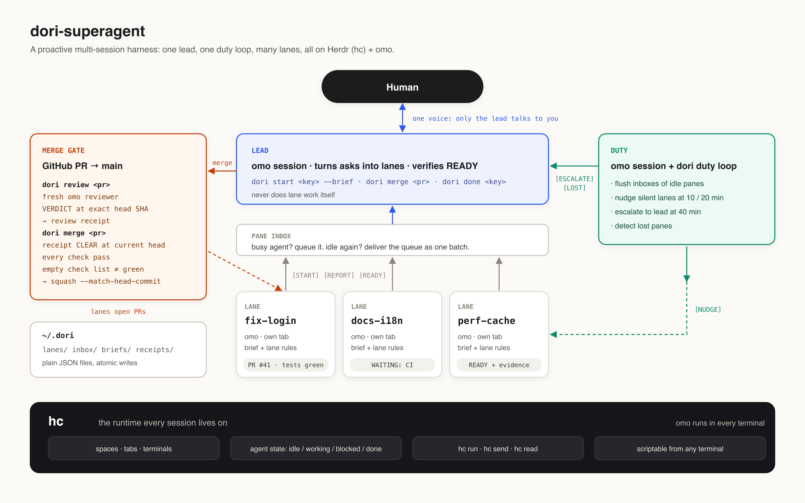
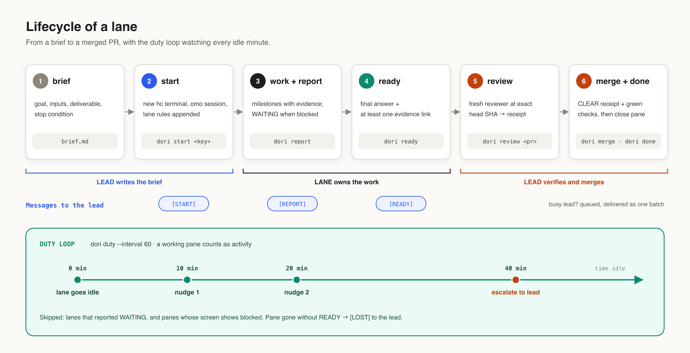

<p align="center">
  
</p>

# Dori

Dein Engineer rund um die Uhr, in dem Chat, den du sowieso nutzt.

[English](README.md) | [简体中文](README.zh.md) | Deutsch | [日本語](README.ja.md) | [Italiano](README.it.md)

[](https://github.com/sisyphuslabs/dori-superagent/actions/workflows/ci.yml)
[](LICENSE)

Dori wohnt in deinem Slack, Discord oder Telegram. Du sagst ihm in einem Thread, was zu tun ist, er gibt dem Job eine eigene Coding-Agent-Session und meldet sich zurück, sobald die Arbeit nachweislich erledigt ist: ein gemergter PR, ein geschlossenes Issue, eine veröffentlichte Version. Zwischen deinen Anfragen sucht er sich die nächste Aufgabe selbst. Mehr Setup gibt es nicht.

Dieses Repository, `dori-superagent`, ist Dori unter der Sustainable Use License. Dori mode (`skills/dori-mode`) ist der Bot, mit dem du redest: ein Skill für deinen Coding-Agent plus eine `dori`-CLI, die die arbeitenden Sessions öffnet, verfolgt und schließt und mit Slack, Discord und Telegram spricht.

Der Harness (`src/`) ist der Maschinenraum dahinter: eine Lead-Session, ein Duty-Loop, ein stündlicher Loop (hourly loop), so viele Lanes, wie der Host trägt, und ein Merge-Gate, in rund 4.600 Zeilen TypeScript auf [Bun](https://bun.sh) ohne Laufzeitabhängigkeiten. Er läuft auf [herdr](https://github.com/herdrdev/herdr), der Terminal-Laufzeitumgebung, in der die Sessions leben (oder auf hc, herdr-core, der Variante ohne Oberfläche aus demselben Projekt), und auf [omo](https://github.com/code-yeongyu/oh-my-openagent), dem Coding-Agent mit 70,8k Sternen auf GitHub.

## Was du bekommst

- Du schreibst in einen Thread. Dori markiert die Nachricht mit einer „eyes“-Reaktion, antwortet innerhalb einer Minute, und solange ein Job läuft, ist sein Status eine einzige Nachricht, die er an Ort und Stelle bearbeitet, mit einer kurzen Fortschrittsnotiz alle 15 Minuten und bei jedem Meilenstein.
- Jeder Job läuft in seinem eigenen herdr-Tab, vom Start bis zum Abschluss in einer Registry erfasst, so viele gleichzeitig, wie der Host trägt. Ein Host-Guard hält neue Starts zurück, wenn Arbeitsspeicher, Festplatte oder die Zahl der Panes seine Grenze überschreiten.
- Kein „fertig“ ohne Beweis. Eine Lane meldet fertig mit Belegen, und die Meldung wird gegen den echten Zustand geprüft: Der PR ist gemergt, das Issue geschlossen, die Version liegt auf npm, der Befehl läuft durch, die URL antwortet. Eine Meldung, die nicht hält, geht innerhalb von 5 Minuten als nicht fertig zurück, und eine Lane mit ungepushter Arbeit lässt sich nicht schließen.
- Nur der Merge löst einen Ping aus. Der Lead ist die einzige Session, die mit dir spricht, und er meldet eine Codeänderung nach dem Merge, mit dem PR und dem Merge-Commit. Lanes und der Duty-Loop sprechen nie mit dir.
- Die Arbeit geht weiter, während du weg bist. Briefs warten in einem Backlog. Einmal pro Stunde räumt der Loop erledigte Einträge ab, prüft die, die niemand geschlossen hat, startet die nächsten, die keine Entscheidung brauchen, und stellt dir jede offene Frage genau einmal.
- Jeder Job bekommt seinen eigenen Thread oder sein eigenes Telegram-Topic, benannt nach seinem Zustand (`[working]`, `[waiting]`, `[done]`), archiviert, wenn er fertig ist, und wieder geöffnet, sobald du erneut hineinschreibst.
- Eine Sprachnachricht wird über deinen Speech-to-Text-Befehl transkribiert und wie Text behandelt.
- Bei einem Neustart geht nichts verloren. Das Arbeitsprotokoll deiner Anfragen, die Checkpoints jeder Lane und die Registry liegen auf der Festplatte, und `dori boot` liest sie zurück, bevor Dori dem traut, woran er sich erinnert.
- Er antwortet in der Sprache des Threads, passt sich deinem Schreibstil an, hält Nachrichten kurz und verwendet keine Emojis.

## Wo Dori wohnt

Slack, Discord und Telegram sind in `skills/dori-mode/scripts/src/messenger/` implementiert. Die Tabelle zeigt, was jede Plattform heute kann. Was nicht drinsteht, macht der Code nicht.

| | Slack | Discord | Telegram |
|---|---|---|---|
| Posten und an Ort und Stelle bearbeiten | Ja, und in Threads antworten | Ja; Erwähnungen im Text pingen niemanden an | Ja, als reiner Text oder HTML mit Tabellen |
| Threads | Slack-Threads | Threads starten, umbenennen und archivieren | Forum-Topics: erstellen, umbenennen, schließen, wieder öffnen |
| Tippen und Streaming | | Tippanzeige | Tippanzeige und ein Entwurf, der wächst, während die Antwort geschrieben wird, beginnend mit "Thinking…" |
| Eingang, wie deine Nachrichten ankommen | `dori inbound slack`: die Threads-Ansicht, jeder Thread, in dem Dori gepostet hat (markiert oder nicht), und ungelesene DMs, Gruppen-DMs und Erwähnungen | Die Watch deines Messenger-Toolings | `dori inbound telegram`: ein Long Poll, der nur die Nachrichten des Besitzers durchlässt, DMs und eine Gruppe (nur eines ihrer Topics, wenn `DORI_TELEGRAM_TOPIC_ID` gesetzt ist), Bearbeitungen eingeschlossen, Medien als File-IDs |
| Präsenz | `dori presence slack` hält ein Mitgliedskonto als online angezeigt | `dori presence discord` meldet sich am Gateway als online an | |
| Dateien | Upload aus der Bibliothek | | File-IDs bei eingehenden Medien |
| Tokens | `DORI_SLACK_TOKEN`, plus `DORI_SLACK_COOKIE` für ein User-Token | `DORI_DISCORD_TOKEN` | `DORI_TELEGRAM_TOKEN`, `DORI_TELEGRAM_OWNER_ID` und optional `DORI_TELEGRAM_GROUP_ID` und `DORI_TELEGRAM_TOPIC_ID` |

Bei Slack entscheidest du beim Setup, wie Dori auftritt. Mit einem User-Token ist er ein echtes Mitglied: ein bezahlter Platz, er sieht alles, was dieses Mitglied sieht, und kann einen grünen Online-Punkt halten. Mit einem Bot-Token ist er eine App: kein Platz, nur die Kanäle, in die er eingeladen ist, innerhalb der Scopes, die du vergibst.

Den Bot anlegen und seinen Login abschließen läuft über [agent-messenger](https://github.com/agent-messenger/agent-messenger). Die Helfer in der Tabelle rufen die API jeder Plattform direkt auf, wiederholen Anfragen bei Rate Limits mit der Wartezeit des Servers und lehnen jeden Text ab, der `$(` enthält, denn Nachrichtentext ist Daten und läuft nie durch eine Shell. Auf jeder Plattform macht `dori transcribe` aus einer Sprachnotiz Text, über den Befehl, den du als `hooks.transcribe` konfigurierst. Teams, WhatsApp, LINE, WeChat, iMessage, KakaoTalk oder Lark unterstützt dieses Repository nicht, und `dori send` lehnt einen Kanal ab, den es nicht kennt.

`dori send <slack|telegram|discord> --to TARGET --text TEXT [--thread ID] [--edit ID]` postet oder bearbeitet eine Nachricht aus der Shell. Dieselben Klassen (`Slack`, `Discord`, `Telegram`) sind importierbare Module, die ihren HTTP-Client und ihre Uhr als Argumente bekommen (die Helfer für Tippen und Präsenz bekommen die Timer). So laufen die Tests ohne Netzwerk.

## Schnellstart

Beide Installationen legen einen Befehl namens `dori` in deinen PATH, installiere also eine pro Maschine. Auf einer Maschine mit beiden startest du den Harness als `bun src/cli.ts` und überlässt `dori` dem Dori mode; die Prompts des Harness rufen ihn ohnehin über seinen vollen Pfad auf.

### Dori mode, der Bot, mit dem du redest

Du brauchst herdr, Bun 1.4.5 oder neuer, git und die GitHub-CLI `gh`.

```sh
curl -fsSL https://raw.githubusercontent.com/sisyphuslabs/dori-superagent/main/install.sh | bash
```

Das klont dieses Repository nach `~/.dori/src`, verlinkt den Skill nach `~/.agents/skills/dori-mode`, verlinkt `dori` in deinen PATH und kopiert eine Beispielkonfiguration nach `~/.dori/config.json`. Bearbeite mindestens `leadPane` (dein eigenes herdr-Pane, aus `herdr pane current`), `laneWorkspace` und `defaultCwd`.

Dann startest du deinen Coding-Agent in herdr und sagst ihm: Dori mode. Er fragt, wie er heißen soll (einfach Dori, oder ShipDori, WorkDori, damit mehrere nebeneinander laufen können), fragt nach dem Messenger, schließt mit dir das Anlegen und den Login des Bots ab und begrüßt dich über den Bot. Bevor er irgendetwas von dir liest, fragt er Tool für Tool um Erlaubnis, und dieses Onboarding ist nur lesend.

Der Betriebsvertrag ist [`skills/dori-mode/SKILL.md`](skills/dori-mode/SKILL.md); Setup, Sessions, das Done-Protokoll und jeder Befehl stehen in seinen [`references/`](skills/dori-mode/references/).

### Der Harness

Du brauchst Bun 1.4.5 oder neuer, herdr, omo und `gh` (für die Head-SHAs von PRs, die Checks und den Merge).

```sh
git clone https://github.com/sisyphuslabs/dori-superagent
cd dori-superagent
bun install
bun link   # puts `dori` on your PATH
```

Starte herdr, dann:

```sh
dori up
# UP runtime=herdr lead=w1:p1 duty=w1:p2 loop=w1:p3 hourly=w1:p4 home=~/.dori
```

Das öffnet einen herdr-Workspace namens `dori` mit einem Lead-Pane (omo, mit `prompts/lead.md` an seinen System-Prompt angehängt), einem Duty-Pane (omo mit `prompts/duty.md`), darunter dem Duty-Loop und darunter dem stündlichen Loop. Sprich mit dem Lead-Pane. Es schreibt einen Brief (Ziel, Eingaben, Ergebnis, Abbruchbedingung, Einschränkungen; siehe [`examples/brief.md`](examples/brief.md)) und öffnet selbst Lanes. Dasselbe kannst du aus einer Shell tun:

```sh
dori start fix-flaky-login --brief examples/brief.md
# STARTED fix-flaky-login pane=w1:p5 brief=~/.dori/briefs/fix-flaky-login.md
dori status
```

Innerhalb der Lane meldet sich omo und schließt ab mit den Befehlen, die ihm seine Lane-Regeln mitgeben:

```sh
dori report fix-flaky-login --text 'reproduced: 1 failure in 20 runs, shared session fixture'
dori report fix-flaky-login --status waiting --text 'WAITING: checks on owner/repo#12'
dori ready fix-flaky-login --text 'root cause fixed in owner/repo#12, checks green' --evidence https://github.com/owner/repo/pull/12
```

Der Lead, bei `[READY fix-flaky-login]`:

```sh
dori review owner/repo#12            # fresh omo reviewer pinned to the head SHA; writes a receipt; exit 0 on CLEAR
dori merge owner/repo#12 --dry-run   # MERGE_OK ... (dry run), or MERGE_REFUSED <why> with exit 2
dori merge owner/repo#12             # gh pr merge --squash --match-head-commit <sha>
dori done fix-flaky-login            # closes the lane's pane; only a READY lane can be closed
```

`bun src/cli.ts` ohne Argumente gibt jeden Befehl mit seinen Flags aus.

## Wie der Harness funktioniert



Drei Rollen, jede eine omo-Session in einem herdr-Pane. herdr stellt die Workspaces, Tabs und Panes bereit, erkennt omo in einem Pane als Agent und meldet dessen Zustand (idle, working, blocked, done) über seine CLI. dori liest diesen Zustand, bevor es irgendetwas mit einem Pane macht.

Der Lead ist die einzige Session, die mit dir spricht. Er macht aus einer Anfrage einen Brief, öffnet mit `dori start` eine Lane, liest, was die Lanes zurückschicken, und mergt.

Eine Lane ist eine omo-Session in ihrem eigenen herdr-Tab, gestartet mit einem Brief, an den die Lane-Regeln angehängt sind (`prompts/lane-footer.md`). Sie meldet Meilensteine mit `dori report` und schließt mit `dori ready` ab, das ohne Beleglink nichts sendet.

Der Duty-Loop ist `dori duty --interval 60`, ein einfacher Prozess in einem Pane neben einer Duty-omo-Session. Bei jedem Tick leert er wartende Nachrichten in Panes, die idle geworden sind, stupst Lanes an, die still geblieben sind, eskaliert an den Lead und markiert eine Lane, deren Pane verschwunden ist, als verloren. `dori duty stop --text 'why'` ist sein Notschalter; bis `dori duty resume` gibt jeder Tick nur aus, warum er angehalten ist.

Der stündliche Loop ist `dori loop`, von `dori up` in einem vierten Pane gestartet. Arbeit wartet in einem Backlog unter `~/.dori/backlog/`, ein Brief pro Eintrag, vom Lead hinzugefügt oder aus GitHub-Issues mit einem Label importiert:

```sh
dori backlog add search-index --brief briefs/search.md --priority 2
dori backlog add new-billing --brief briefs/billing.md --decision 'charge per seat or per workspace?'
dori backlog import owner/repo --label dori     # label p1..p9 sets the priority, needs-decision marks a question
```

Ein Lauf, der sein Gate passiert (nicht gestoppt, nicht von einem anderen Loop gesperrt, mindestens ein Intervall seit dem letzten Lauf), gleicht zuerst die Einträge mit dem Zustand der Lanes und PRs ab. Dann prüft er liegengebliebene Arbeit: eine Lane, die seit 3 Stunden still ist, eine READY-Lane, die seit 2 Stunden niemand geschlossen hat, ein verschwundenes Pane. Danach holt er die nächsten offenen Einträge, innerhalb von `--max-lanes` (Standard 3) offenen Lanes und `--max-starts` (Standard 2) pro Lauf, solange der Host Last und Arbeitsspeicher übrig hat. Jede offene Frage erreicht den Lead einmal als `[DECIDE <id>]`, mit einer Erinnerung nach 6 Stunden, und der Lauf endet mit einem `[LOOP ...]`-Bericht an den Lead.

Der Loop öffnet nur Lanes und sendet Nachrichten; er mergt nie, pusht nie und schließt nie ein Pane. Das vollständige Design steht in [`docs/hourly-loop.md`](docs/hourly-loop.md).



`dori start <key> --brief FILE` schreibt den Brief plus die Lane-Regeln nach `~/.dori/briefs/<key>.md`, öffnet einen Tab, startet omo mit einem Prompt, der den Brief nennt, erfasst die Lane als `working` und schickt dem Lead `[START <key>]`. Von da an meldet sich die Lane (`[REPORT <key>]`, oder `[REPORT <key> WAITING]`, wenn sie außerhalb ihres eigenen Panes blockiert ist) und endet mit `[READY <key>]` plus ihren Beleglinks. Eine Lane, die idle bleibt, wird nach 10 und 20 Minuten angestupst und nach 40 an den Lead eskaliert. Eine Lane, deren Pane vor READY verschwindet, wird als `[LOST <key>]` gemeldet.

Der Zustand liegt als JSON auf der Festplatte unter `~/.dori` (oder `$DORI_HOME`): `lanes/`, `inbox/`, `briefs/`, `receipts/`, dazu `backlog/` und `loop/` für den stündlichen Loop und `duty/` für die Stoppdatei des Duty-Loops. Neben den Agent-Sessions fügt der Harness als langlaufende Prozesse nur die beiden Loops hinzu, und die einzige Laufzeitabhängigkeit ist Bun.

### Zwei Session-Laufzeiten

Sessions laufen auf herdr oder auf hc ([herdr-core](https://releases.herdr.dev/core/install.sh)), und ein Home kann Sessions auf beiden halten. Der Harness spricht mit ihnen über eine Schnittstelle in `src/runtime/`, und jede gespeicherte Lane und Rolle merkt sich, welche Laufzeit sie geöffnet hat, sodass Befehle an sie dorthin gehen, welche Laufzeit auch gewählt ist. Neue Sessions öffnen auf der Laufzeit, die `DORI_RUNTIME` nennt, sonst auf der aus `"runtime": "herdr"` oder `"runtime": "hc"` in `$DORI_HOME/config.json`; ist nichts gesetzt, wählt Dori in einem hc-Terminal hc, in einem herdr-Pane herdr und sonst hc, wenn es installiert ist, andernfalls herdr. hc ist die Standard-Laufzeit; nur wenn keines von beiden auf dem PATH liegt, lehnt Dori mit einer einzeiligen Korrektur ab. `dori status` gibt die Wahl zuerst aus, als `RUNTIME hc (from config)`.

Auf hc gibt es keine Workspaces und Tabs: Dori öffnet pro Session ein beschriftetes Terminal, und der Status einer Session kommt nur aus dem eigenen Bericht des Agenten (eine OSC-7501-Sequenz, die neuere omo-Builds senden); ein Agent, der nie berichtet, bleibt `unknown`, und seine Nachrichten warten in der Inbox. `dori migrate --to hc --all` (oder `--lane <key>`, `--role duty-loop`, mit `--dry-run` für den Plan) zieht Sessions auf die andere Laufzeit um: es erfasst ein Übergabe-Briefing, öffnet den Ersatz, zieht die Inbox um und schließt die alte Session, mit `MIGRATED`, `SKIP`, `DEFERRED` oder `MIGRATE_ROLLBACK` pro Session. Die Zuordnung Verb für Verb steht in [`docs/runtime.md`](docs/runtime.md).

## Was der Harness durchsetzt

### Eine Stimme

Der Lead ist die einzige Session, die mit dir spricht (`prompts/lead.md`). Die Lane-Regeln schicken jede Information, die für dich gedacht ist, an den Lead (`prompts/lane-footer.md`, Regel 3), und die Duty-Session mergt nie und spricht nie mit dir (`prompts/duty.md`).

### READY braucht Belege

`dori ready` verweigert ohne mindestens einen `--evidence`-Link und ohne finalen Antworttext. Beides wird im Lane-Eintrag gespeichert, und `dori done` verweigert jede Lane, die nicht `ready` ist. So schließt keine Lane ohne festgehaltene Antwort.

### Beschäftigte Panes werden nie unterbrochen, und nichts wird doppelt gesendet

`dori send` fragt herdr zuerst nach dem Agent-Zustand des Panes. Bei `idle` oder `done` geht die Nachricht sofort raus; alles andere landet in der Warteschlange in `~/.dori/inbox/`, und der Duty-Loop stellt die Warteschlange zu, sobald das Pane idle wird, als ein Paket. In ein Pane, in dem vorne eine Shell läuft, wird nie getippt, denn getippter Text würde als Befehl ausgeführt.

Wenn eine Zustellung fehlschlug, nachdem der Text das Pane womöglich schon erreicht hat, wird später nur Enter gedrückt, und nur in den Agent, in den getippt wurde; sieht herdr dann einen anderen Agent, wird der Eintrag festgehalten, der Lead bekommt einmal `[DELIVERY-AMBIGUOUS <pane>]`, und `dori inbox ack` oder `dori inbox resend` klärt es von Hand.

### Anstupser nach 10, 20 und 40 Minuten

Eine Lane, die sich 10 Minuten nicht gemeldet hat und deren Pane nicht arbeitet, bekommt `prompts/nudge.md` in ihr Pane, nach 20 noch einmal, und nach 40 schickt der Duty-Loop dem Lead `[ESCALATE <key>]`. Eine Lane, die `--status waiting` gemeldet hat oder deren Pane `blocked` ist, bleibt in Ruhe.

### Merge braucht ein CLEAR-Receipt am exakten Head und grüne Checks

`dori merge` liest mit `gh` die Head-SHA des PRs und verlangt dann für genau diese SHA ein Receipt in `~/.dori/receipts/` mit dem Urteil `CLEAR`. Receipts schreibt nur `dori review`: Es startet ein frisches, nicht interaktives omo auf `prompts/review.md`, festgenagelt auf diese SHA, und wenn der Reviewer keine `VERDICT:`-Zeile ausgibt, wird kein Receipt geschrieben.

Dann muss `gh pr checks` mindestens einen Check liefern, jeder Check muss `pass` oder `skipping` sein, und mindestens einer muss `pass` sein. Eine leere Check-Liste wird abgelehnt mit "an empty check list is never green". Ein Push nach dem Review ändert die Head-SHA, damit passt das Receipt nicht mehr, und `dori review` muss erneut laufen.

### Hooks für dein eigenes Tooling

`$DORI_HOME/config.json` kann unter `hooks` argv-Vorlagen nennen: `onReady`, `onReport` und `onLost` laufen im Hintergrund, wenn diese Ereignisse eintreten (mit `{key}`, `{text}` und `{evidence}` pro Argument eingesetzt), und `reviewCommand` ersetzt den eingebauten Reviewer, solange es dieselbe `VERDICT:`-Zeile ausgibt. `DORI_PROMPTS_DIR` verweist den Harness auf deine eigenen Kopien der Prompts.

## Dori mode im Detail

### Routing

Eine Frage, eine Statusabfrage, ein Nachschlagen oder eine kleine Änderung erledigt Dori in seiner eigenen Session. Code, der als PR landet, mehrstufige Arbeit oder alles, was lang oder parallel ist, bekommt eine Lane; besitzt schon eine idle Lane dieses Repo oder Thema, geht die Arbeit dorthin. Sagt `dori can-launch` `HOLD` (Arbeitsspeicher, Festplatte oder Pane-Zahl über der Grenze des Guards), wird nichts geöffnet, und du erfährst, warum und wann es startet.

### Fertig ist eine Behauptung, keine Tatsache

`dori launch` akzeptiert eine `Done =`-Zeile nur, wenn der Watcher jedes Signal selbst zurücklesen kann. Signale werden mit `;` verbunden, und die Lane ist fertig, wenn alle bestehen:

| Signal | Besteht, wenn |
|---|---|
| `merged <owner/repo>#N` | der PR gemergt ist und einen Merge-Commit hat |
| `closed <owner/repo>#N` | das Issue geschlossen ist |
| `published <pkg>@<version>` | npm genau diese Version hat |
| `command ["argv","as","json"] [stdout~"regex"]` | der Befehl mit 0 endet und stdout auf die Regex passt, falls eine angegeben ist |
| `file <path> [sha256=<hex>] [json:.a.b=<value>]` | die Datei existiert, ihr sha256 passt und das JSON-Feld dem Wert entspricht |
| `url <http(s) url> [status=200] [body~"regex"]` | ein GET diesen Status liefert und der Body passt, falls eine Regex angegeben ist |

Eine Lane meldet mit `dori claim-done <key> --evidence "..."`. `dori watch` entscheidet über Meldungen, die älter als 5 Minuten sind: Ungepushte oder nicht committete Arbeit und fehlschlagende Signale werden zu Einwänden, andernfalls wird die Lane geschlossen: ihr Thread wird als fertig markiert, wenn ein Thread-Hook konfiguriert ist, ihr Tab wird geschlossen und ihre Worktrees werden entfernt.

### Bevor ein PR als fertig gilt

`dori verify-pr <owner/repo> <num>` liest den PR über `gh api` und prüft, dass die Author- und Committer-E-Mail jedes Commits die für dieses Repo konfigurierte Identität ist und dass `fix:`-Commits, die Quellcode anfassen, einen geänderten Test oder eine `No test:`-Begründung mitbringen.

### Lektionen

`dori lesson add` hält eine Regel fest, die eine Lane über ein Repo gelernt hat, verknüpft mit dem Beleg, aus dem sie stammt. Eine `--global`-Lektion ist eine feste Regel vom Lead für jede Lane. `dori launch` stellt die aktuellen über den nächsten Brief.

### Überwachung

Jeder `freshness`-Tick prüft gestartete Lanes gegen optionale Obergrenzen für Wandzeit in Minuten, Tokens und Kosten (aus einem Usage-Befehl, den du konfigurierst) und markiert eine Lane als hängend, wenn ihr `Working`-Timer 20 Minuten lang weiterläuft, ohne neuen Bericht, Checkpoint oder Dateiänderung. Eine Lane an einer Obergrenze wird nie beendet; sie wartet auf den Lead.

### Wenn du „warte“ sagst

`dori pause <key>` pausiert das Ziel der Lane und stoppt ihren laufenden Turn und gibt `PAUSE_UNVERIFIED` aus, wenn es die Pause nicht bestätigen konnte. `dori resume <key>` nimmt sie wieder auf.

## Gleiche Struktur, gleiche Philosophie

DeepSeek hat [dsh-superagent-prototype](https://github.com/deepseek-ai/dsh-superagent-prototype) veröffentlicht (erster Commit am 2026-10-31) und etwa einen Tag später den Artikel „Exploring Super-agent Design: Towards a More Autonomous Agent System“. Leg die Doku neben Dori, und die Konzepte passen eins zu eins zusammen, in der Pipeline und in den Regeln ihres [Philosophie-Dokuments](https://github.com/deepseek-ai/dsh-superagent-prototype/blob/main/docs/000-philosophy.md).


| DeepSeek dsh-superagent | Dori |
|---|---|
| Quelle: GitHub, Feishu | Dori wohnt im Chat: Slack, Discord, Telegram |
| Trigger, dann Eval, dann Ticket | Eine im Chat gestellte Aufgabe wird zu einer Lane mit einem Brief |
| Executor-Session pro Ticket: eine Session, ein Arbeitsverzeichnis | Eine Coding-Agent-Session pro Aufgabe, in ihrem eigenen herdr-Tab, viele parallel |
| Channel: antwortet in der ursprünglichen Unterhaltung, zum Beispiel mit einem PR | Berichtet im selben Thread, eine Statusnachricht pro Aufgabe, an Ort und Stelle bearbeitet |
| Panel: zeigt nur, was ein Mensch braucht | Der Lead fragt dich nur nach Entscheidungen, die unumkehrbar sind oder das Produkt verändern |
| Möglichst wenig menschliche Aufmerksamkeit, möglichst viel Wert | Kurze Nachrichten, keine Emojis, ein Ping erst nach dem Merge |
| Handelt nur auf Anfrage oder wenn eine schriftliche Teamregel es erlaubt | Dori startet keine Arbeit, um die niemand gebeten hat; das Backlog enthält, was du eingereiht hast |
| Spricht nur, wenn ein Mensch handeln muss, eine Frage nach der anderen | Eine Entscheidung kommt als nummerierte Optionen mit seiner eigenen Wahl |
| Berichtet ehrlich, umgeht nie eine Blockade | Kein „fertig“ ohne Beweis, und eine Blockade wird als Blockade gemeldet |

Wir betreiben diese Form seit etwa sechs Monaten, öffentlich:

- 2026-04-18: Der Team-Modus landet in omo, mehrere Agent-Sessions in Terminal-Panes mit je einem Worktree ([f1268c0](https://github.com/code-yeongyu/oh-my-openagent/commit/f1268c0), [e303fee](https://github.com/code-yeongyu/oh-my-openagent/commit/e303fee)).
- 2026-05-06: Der Name Dori kommt in die omo-README ([#3807](https://github.com/code-yeongyu/oh-my-openagent/pull/3807)).
- 2026-10-07: Dieses Repository veröffentlicht Dori mode, als `omo-dori-mode-experimental` ([ce53e4d](https://github.com/sisyphuslabs/dori-superagent/commit/ce53e4d)).
- 2026-10-31: DeepSeeks Prototyp bekommt seinen ersten Commit.

So wird omo selbst gebaut. Zwischen 2026-07-13 und 2026-11-08 hat [code-yeongyu/oh-my-openagent](https://github.com/code-yeongyu/oh-my-openagent) 2.846 Pull Requests gemergt und 18.780 Commits aufgenommen, alle Mitwirkenden mitgezählt, entstanden mit der vollen Version dieses Setups. Der Harness in diesem Repository ist die minimale Version: der Teil, der allein auf herdr und omo läuft.

## Konfiguration

Umgebung des Harness:

| Variable | Standard | Bedeutung |
|---|---|---|
| `DORI_HOME` | `~/.dori` | Zustandsverzeichnis |
| `DORI_AGENT_CMD` | `omo` | der Agent, den jedes Pane ausführt |
| `DORI_HERDR_SESSION` | | eine benannte herdr-Session |
| `DORI_RUNTIME` | die Laufzeit, in der du gerade sitzt, sonst `hc`, wenn es auf dem PATH liegt, andernfalls `herdr` | auf welcher Laufzeit neue Sessions öffnen: `herdr`, oder `hc` (herdr-core, die Session-Laufzeit ohne Oberfläche aus demselben Projekt); der Schlüssel `runtime` in `$DORI_HOME/config.json` tut dasselbe, und wenn keines der Programme auf dem PATH liegt, nichts gesetzt ist und du in keinem Pane oder Terminal von beiden sitzt, lehnt `dori` mit einer einzeiligen Korrektur ab |
| `DORI_CMD` | voller Pfad zu `src/cli.ts` | wie die Agents dori aufrufen sollen |
| `DORI_PROMPTS_DIR` | `prompts/` des Repos | deine eigenen Prompt-Dateien |
| `DORI_MAX_LANES`, `DORI_MAX_STARTS`, `DORI_MAX_LOAD` | 3, 2, Anzahl der Kerne | Budget des stündlichen Loops |
| `DORI_TELEMETRY`, `DORI_TELEMETRY_ENDPOINT` | an, `https://t.omo.dev` | `0` schaltet Telemetrie ab |

Dori mode liest `~/.dori/config.json` (oder `DORI_CONFIG`); jedes Feld ist optional, und [`config.example.json`](skills/dori-mode/references/config.example.json) zeigt sie alle. Die, die du zuerst setzt: `leadPane`, `laneWorkspace`, `defaultCwd`, `agentCommand` und `defaultModel`, `repoIdentities` (der Git-Name und die E-Mail, die `verify-pr` pro Repo erwartet), `hooks.threadReply` und `hooks.threadDone` (deine Messenger-CLI, als argv-Vorlagen mit `{thread}` und `{text}`), `hooks.transcribe` und `guard` (Last, freier Arbeitsspeicher, freier Festplattenplatz und Pane-Zahl). Zeitliche Standards: ein Anstupser nach 15 stillen Minuten, der letzte Bericht nach 20 im Thread gepostet, eine Fertig-Meldung nach 5 entschieden.

## In einem Container betreiben

[`examples/container/`](examples/container/) enthält ein Dockerfile, eine Compose-Datei und einen Entrypoint für einen langlebigen Container mit gh, node, bun, herdr, agent-messenger, omo und dem Harness: Jedes heruntergeladene Binary wird gegen einen festgelegten sha256 geprüft, und die npm-Pakete und der Harness sind über Version und Commit festgenagelt. Ein Image wird nicht veröffentlicht. Du baust es selbst, erledigst die Logins einmal im laufenden Container, und benannte Volumes behalten sie. [`docs/container.md`](docs/container.md) beschreibt den Build, den ersten Start und wie du dich verbindest.

## Telemetrie

dori sendet anonyme Nutzungszahlen auf dieselbe Weise wie omo: OTLP/HTTP-JSON-Logs an den omo-Collector unter `https://t.omo.dev`. Die Identität ist eine zufällige Installations-ID in `~/.dori/telemetry.json`, und gesendet wird nur ihr sha256. Beim ersten Senden erzeugt der Collector aus diesem Hash einen Ingest-Key pro Installation; im Code wird kein gemeinsamer Key ausgeliefert. Der erste Start gibt einen einzeiligen Hinweis aus. Abschalten kannst du sie mit `DORI_TELEMETRY=0` (`DO_NOT_TRACK=1` funktioniert auch).

| Ereignis | Wann | Felder |
|---|---|---|
| `dori.installed` | erster Start | keine |
| `dori.daily_active` | einmal pro UTC-Tag, bei jedem dori-Befehl | `day_utc` |
| `dori.lane_started` | `dori start` | `open_lanes` |
| `dori.lane_ready` | `dori ready` | `evidence_count`, `lane_minutes` |
| `dori.review_completed` | `dori review` | `verdict`: `CLEAR` oder `BLOCK` |
| `dori.merge_decided` | `dori merge` ohne `--dry-run` | `outcome` |
| `dori.duty_summary` | höchstens einmal pro Stunde, vom Duty-Loop | `ticks`, `flushed`, `nudges`, `escalations`, `lost` |

Jeder Eintrag enthält außerdem den Dienstnamen und die Version, den Installations-Hash, ein CI-Flag, Typ und Version des Betriebssystems und die CPU-Architektur. Nie gesendet werden: Pfade, Repo-Namen, PR-Nummern, Lane-Keys, Briefs, Nachrichten oder sonst irgendein Text. Ein Befehl wartet höchstens 2 Sekunden auf das Senden, und ein Telemetriefehler lässt nie einen Befehl fehlschlagen.

## Tests und Entwicklung

```sh
bun test ./test/                                  # the harness: 386 tests across 42 files, no model calls
cd skills/dori-mode/scripts && bun install && bun test   # Dori mode: 321 tests across 44 files
bun run ci                                        # biome, tsc, knip, the 250-line check, both suites
```

Die Tests des Harness laufen gegen ein gefälschtes herdr, ein gefälschtes hc und ein gefälschtes gh mit einer Uhr, die die Tests vorstellen; die End-to-End-Tests starten einen echten herdr-Server oder einen echten hc-Core in einer isolierten Session mit einem gefälschten Agent-Skript anstelle von omo, und jeder überspringt sich, wenn sein Programm nicht im PATH liegt. Die Tests von Dori mode laufen gegen gefälschtes herdr, git und gh und fassen nichts Echtes an. Die CI führt dasselbe auf Ubuntu und macOS aus.

## Was das hier nicht ist

Der Harness ist die minimale Version und nicht unser Produktions-Stack. Absichtlich weggelassen: das maschinenübergreifende Mesh, das Heavy-Slot-Scheduling, die Brücken zu Chat und Ticket-Tracker und Receipts für ganze Testsuites. Der Teil, der allein auf herdr und omo läuft, ist hier: Rollen, Lanes, die Inbox, der Duty-Loop, der stündliche Loop und das Backlog sowie das Review- und Merge-Gate. Dori mode ist eine eigene CLI mit eigenen Messenger-Bausteinen, Host-Guard und Heavy-Slot-Runner; der Harness importiert nichts davon.

## Mitwirken

Jeder Mitwirkende unterschreibt einmal das [Contributor License Agreement](CLA.md), mit dem Kommentar `I have read the CLA Document and I hereby sign the CLA` unter seinem ersten Pull Request; der CLA-Assistant-Check hält das fest. Die Gates, die Testbefehle und die Regeln für Pull Requests stehen in [CONTRIBUTING.md](CONTRIBUTING.md).

## Lizenz

Die [Sustainable Use License](LICENSE) Version 1.0, dieselbe Lizenz wie bei omo, mit Drittkomponenten unter ihren eigenen Lizenzen. Sie deckt deinen eigenen internen Geschäftsgebrauch sowie nicht kommerzielle oder private Nutzung ab; kommerzielle Nutzung braucht eine Lizenz des Eigentümers. Commits vor `ba96abf` erschienen unter MIT.
