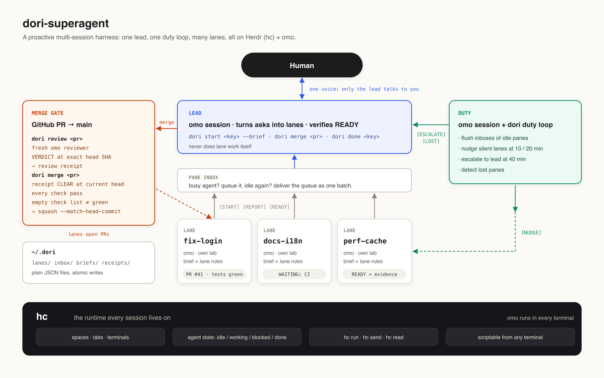
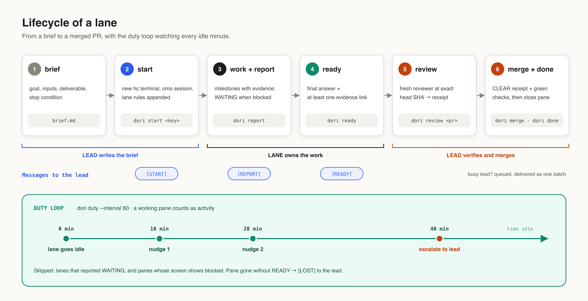

<p align="center">
  
</p>

# Dori

Il tuo ingegnere 24/7, nella chat che usi già.

[English](README.md) | [简体中文](README.zh.md) | [Deutsch](README.de.md) | [日本語](README.ja.md) | Italiano

[](https://github.com/sisyphuslabs/dori-superagent/actions/workflows/ci.yml)
[](LICENSE)

Dori vive nel tuo Slack, Discord o Telegram. Gli dici cosa fare in un thread, lui dà al lavoro una sessione di coding agent tutta sua e ti risponde quando il lavoro è dimostrato concluso: una PR con merge, una issue chiusa, una versione pubblicata. Tra una richiesta e l'altra trova da solo il compito successivo. Tutto qui.

Questo repository, `dori-superagent`, è Dori con la Sustainable Use License. Dori mode (`skills/dori-mode`) è il bot con cui parli: una skill per il tuo coding agent più una CLI `dori` che apre, segue e chiude le sessioni che fanno il lavoro, e parla con Slack, Discord e Telegram.

L'harness (`src/`) è la sala macchine dietro di lui: una sessione lead, un duty loop, un hourly loop, tante lane quante l'host ne regge e un merge gate, in circa 4.600 righe di TypeScript su [Bun](https://bun.sh) senza dipendenze a runtime. Gira su [herdr](https://github.com/herdrdev/herdr), il runtime da terminale in cui vivono le sessioni (oppure su hc, herdr-core, la versione senza interfaccia dello stesso progetto), e su [omo](https://github.com/code-yeongyu/oh-my-openagent), il coding agent, che ha 70.8k stelle su GitHub.

## Cosa ottieni

- Scrivi in un thread. Dori segna il messaggio con la reaction "eyes", risponde entro un minuto e, mentre un lavoro è in corso, il suo stato è un unico messaggio che lui modifica sul posto, con una breve nota di avanzamento ogni 15 minuti e a ogni milestone.
- Ogni lavoro gira nella propria tab di herdr, registrato in un registro dall'avvio alla chiusura, tanti in parallelo quanti l'host ne regge. Un host guard blocca i nuovi avvii quando memoria, disco o numero di pane superano la sua soglia.
- Niente "fatto" senza prova. Una lane dichiara il lavoro concluso con le prove, e la dichiarazione viene confrontata con lo stato reale: la PR ha il merge, la issue è chiusa, la versione è su npm, il comando passa, l'URL risponde. Una dichiarazione che non regge torna indietro come non conclusa entro 5 minuti, e una lane con lavoro non pushato non può chiudersi.
- Ricevi un ping solo per il merge. Il lead è l'unica sessione che ti parla, e ti segnala una modifica al codice dopo il merge, con la PR e il commit di merge. Le lane e il duty loop non ti parlano mai.
- Il lavoro va avanti mentre sei via. I brief aspettano in un backlog. Una volta all'ora il loop ritira gli elementi finiti, controlla quelli che nessuno ha chiuso, avvia i successivi che non richiedono decisioni e ti fa ogni domanda aperta una volta sola.
- Ogni lavoro ha il suo thread o topic Telegram, con il nome che riporta lo stato (`[working]`, `[waiting]`, `[done]`), archiviato quando è finito e riaperto quando ci scrivi di nuovo.
- Un messaggio vocale viene trascritto con il tuo comando di speech-to-text e gestito come testo.
- Un riavvio non perde nulla. Il worklog delle tue richieste, i checkpoint di ogni lane e il registro stanno su disco, e `dori boot` li rilegge prima che Dori si fidi di quello che ricorda.
- Risponde nella lingua del thread, si adegua al tuo modo di scrivere, tiene i messaggi brevi e non usa emoji.

## Dove vive Dori

Slack, Discord e Telegram sono implementati in `skills/dori-mode/scripts/src/messenger/`. La tabella elenca cosa fa ciascuno oggi; quello che non c'è, il codice non lo fa.

| | Slack | Discord | Telegram |
|---|---|---|---|
| Pubblicare e modificare sul posto | Sì, e risposte nei thread | Sì; le menzioni nel testo non notificano mai nessuno | Sì, testo semplice o HTML con tabelle |
| Thread | Thread di Slack | Avvia, rinomina e archivia thread | Topic del forum: crea, rinomina, chiudi, riapri |
| Digitazione e streaming | | Indicatore di digitazione | Indicatore di digitazione, e una bozza che cresce mentre la risposta viene scritta, partendo da "Thinking…" |
| In entrata, come arrivano i tuoi messaggi | `dori inbound slack`: la vista Threads, ogni thread in cui Dori ha scritto (con tag o no), e DM, DM di gruppo e menzioni non letti | Il watch del tuo strumento di messaggistica | `dori inbound telegram`: un long poll che lascia passare solo i messaggi del proprietario, i DM e un gruppo (solo uno dei suoi topic quando `DORI_TELEGRAM_TOPIC_ID` è impostato), modifiche incluse, media come file id |
| Presenza | `dori presence slack` mantiene un account membro visibile online | `dori presence discord` si identifica sul gateway come online | |
| File | Upload dalla libreria | | File id sui media in entrata |
| Token | `DORI_SLACK_TOKEN`, più `DORI_SLACK_COOKIE` per un user token | `DORI_DISCORD_TOKEN` | `DORI_TELEGRAM_TOKEN`, `DORI_TELEGRAM_OWNER_ID`, e facoltativamente `DORI_TELEGRAM_GROUP_ID` e `DORI_TELEGRAM_TOPIC_ID` |

Su Slack scegli in fase di setup come appare Dori. Con un user token è un vero membro: un posto a pagamento, vede tutto quello che vede quel membro e può tenere il pallino verde di online. Con un bot token è un'app: nessun posto, solo i canali in cui viene invitato, entro gli scope che concedi.

La creazione del bot e il completamento del suo login passano da [agent-messenger](https://github.com/agent-messenger/agent-messenger). Gli helper della tabella chiamano direttamente l'API di ogni piattaforma, ritentano sui rate limit con il tempo di attesa indicato dal server e rifiutano qualsiasi testo che contenga `$(`, perché il testo di un messaggio è un dato e non passa mai da una shell. Su ogni piattaforma, `dori transcribe` trasforma una nota vocale in testo con il comando che configuri come `hooks.transcribe`. Questo repository non supporta Teams, WhatsApp, LINE, WeChat, iMessage, KakaoTalk o Lark, e `dori send` rifiuta un canale che non conosce.

`dori send <slack|telegram|discord> --to TARGET --text TEXT [--thread ID] [--edit ID]` pubblica o modifica un messaggio dalla shell. Le stesse classi (`Slack`, `Discord`, `Telegram`) sono moduli importabili che ricevono come argomenti il client HTTP e l'orologio (gli helper per typing e presenza ricevono i timer), ed è così che i test girano senza rete.

## Avvio rapido

Entrambe le installazioni mettono nel PATH un comando chiamato `dori`, quindi installane una per macchina. Su una macchina che le ha tutte e due, lancia l'harness come `bun src/cli.ts` e lascia `dori` a Dori mode; i prompt dell'harness lo chiamano comunque con il percorso completo.

### Dori mode, il bot con cui parli

Ti servono herdr, Bun 1.4.5 o successivo, git e la CLI di GitHub `gh`.

```sh
curl -fsSL https://raw.githubusercontent.com/sisyphuslabs/dori-superagent/main/install.sh | bash
```

Questo clona il repository in `~/.dori/src`, collega la skill in `~/.agents/skills/dori-mode`, collega `dori` nel tuo PATH e copia una config di esempio in `~/.dori/config.json`. Modifica almeno `leadPane` (il tuo pane di herdr, da `herdr pane current`), `laneWorkspace` e `defaultCwd`.

Poi avvia il tuo coding agent dentro herdr e digli: Dori mode. Ti chiede come chiamarlo (semplicemente Dori, oppure ShipDori, WorkDori, così ne possono girare diversi affiancati), ti chiede quale messenger usare, completa con te la creazione e il login del bot e ti saluta tramite il bot. Prima di leggere qualsiasi cosa tua chiede il permesso strumento per strumento, e quell'onboarding è in sola lettura.

Il contratto operativo è [`skills/dori-mode/SKILL.md`](skills/dori-mode/SKILL.md); setup, sessioni, il protocollo di conclusione e ogni comando sono nei suoi [`references/`](skills/dori-mode/references/).

### L'harness

Ti servono Bun 1.4.5 o successivo, herdr, omo e `gh` (per gli SHA di head delle PR, i check e il merge).

```sh
git clone https://github.com/sisyphuslabs/dori-superagent
cd dori-superagent
bun install
bun link   # puts `dori` on your PATH
```

Avvia herdr, poi:

```sh
dori up
# UP runtime=herdr lead=w1:p1 duty=w1:p2 loop=w1:p3 hourly=w1:p4 home=~/.dori
```

Questo apre un workspace di herdr chiamato `dori` con un pane lead (omo con `prompts/lead.md` aggiunto al suo system prompt), un pane duty (omo con `prompts/duty.md`), il duty loop sotto di esso e l'hourly loop ancora più sotto. Parla con il pane lead. Scrive un brief (obiettivo, input, deliverable, condizione di stop, vincoli; vedi [`examples/brief.md`](examples/brief.md)) e apre le lane da solo. Puoi fare lo stesso da una shell:

```sh
dori start fix-flaky-login --brief examples/brief.md
# STARTED fix-flaky-login pane=w1:p5 brief=~/.dori/briefs/fix-flaky-login.md
dori status
```

Dentro la lane, omo fa rapporto e chiude con i comandi che gli danno le regole della lane:

```sh
dori report fix-flaky-login --text 'reproduced: 1 failure in 20 runs, shared session fixture'
dori report fix-flaky-login --status waiting --text 'WAITING: checks on owner/repo#12'
dori ready fix-flaky-login --text 'root cause fixed in owner/repo#12, checks green' --evidence https://github.com/owner/repo/pull/12
```

Il lead, su `[READY fix-flaky-login]`:

```sh
dori review owner/repo#12            # fresh omo reviewer pinned to the head SHA; writes a receipt; exit 0 on CLEAR
dori merge owner/repo#12 --dry-run   # MERGE_OK ... (dry run), or MERGE_REFUSED <why> with exit 2
dori merge owner/repo#12             # gh pr merge --squash --match-head-commit <sha>
dori done fix-flaky-login            # closes the lane's pane; only a READY lane can be closed
```

`bun src/cli.ts` senza argomenti stampa ogni comando con i suoi flag.

## Come funziona l'harness



Tre ruoli, ognuno una sessione omo in un pane di herdr. herdr fornisce workspace, tab e pane, riconosce omo in un pane come agente e ne riporta lo stato (idle, working, blocked, done) tramite la sua CLI. dori legge quello stato prima di fare qualsiasi cosa a un pane.

Il lead è l'unica sessione che ti parla. Trasforma una richiesta in un brief, apre una lane con `dori start`, legge quello che le lane rimandano e fa il merge.

Una lane è una sessione omo nella propria tab di herdr, avviata con un brief a cui sono aggiunte le regole della lane (`prompts/lane-footer.md`). Segnala le milestone con `dori report` e chiude con `dori ready`, che non invia nulla senza un link di prova.

Il duty loop è `dori duty --interval 60`, un semplice processo in un pane accanto a una sessione omo di duty. A ogni tick svuota i messaggi in coda nei pane diventati idle, sollecita le lane rimaste in silenzio, passa la questione al lead e segna come persa una lane il cui pane è sparito. `dori duty stop --text 'why'` è il suo interruttore di emergenza; finché non dai `dori duty resume`, ogni tick stampa solo il motivo per cui è fermo.

L'hourly loop è `dori loop`, avviato da `dori up` in un quarto pane. Il lavoro aspetta in un backlog sotto `~/.dori/backlog/`, un brief per elemento, aggiunto dal lead o importato dalle issue GitHub che portano un'etichetta:

```sh
dori backlog add search-index --brief briefs/search.md --priority 2
dori backlog add new-billing --brief briefs/billing.md --decision 'charge per seat or per workspace?'
dori backlog import owner/repo --label dori     # label p1..p9 sets the priority, needs-decision marks a question
```

Un'esecuzione che supera il suo gate (non fermata, non bloccata da un altro loop, almeno un intervallo dall'ultima esecuzione) prima sincronizza gli elementi con lo stato delle lane e delle PR. Poi controlla il lavoro trascurato: una lane in silenzio da 3 ore, una lane READY che nessuno ha chiuso da 2, un pane sparito. Poi prende i prossimi elementi aperti, entro `--max-lanes` (predefinito 3) lane aperte e `--max-starts` (predefinito 2) per esecuzione, finché l'host ha carico e memoria disponibili. Ogni domanda aperta arriva al lead una volta come `[DECIDE <id>]`, con un solo promemoria dopo 6 ore, e l'esecuzione termina con un unico rapporto `[LOOP ...]` al lead.

Il loop apre solo lane e invia messaggi; non fa mai merge, push né chiude un pane. Il design completo è in [`docs/hourly-loop.md`](docs/hourly-loop.md).



`dori start <key> --brief FILE` scrive il brief più le regole della lane in `~/.dori/briefs/<key>.md`, apre una tab, lancia omo con un prompt che nomina il brief, registra la lane come `working` e invia al lead `[START <key>]`. Da lì la lane fa rapporto (`[REPORT <key>]`, oppure `[REPORT <key> WAITING]` quando è bloccata fuori dal proprio pane) e chiude con `[READY <key>]` più i suoi link di prova. Una lane che resta idle riceve un sollecito a 10 e 20 minuti e viene segnalata al lead a 40. Una lane il cui pane sparisce prima di READY viene riportata come `[LOST <key>]`.

Lo stato è JSON su disco sotto `~/.dori` (o `$DORI_HOME`): `lanes/`, `inbox/`, `briefs/`, `receipts/`, più `backlog/` e `loop/` per l'hourly loop e `duty/` per il file di stop del duty loop. Oltre alle sessioni degli agenti, gli unici processi di lunga durata che l'harness aggiunge sono i due loop, e l'unica dipendenza a runtime è Bun.

### Due runtime di sessione

Le sessioni girano su herdr o su hc ([herdr-core](https://releases.herdr.dev/core/install.sh)), e una home può contenere sessioni su entrambi. L'harness parla con loro attraverso un'unica interfaccia in `src/runtime/`, e ogni lane e ruolo salvato ricorda quale runtime l'ha aperto, così i comandi su di esso vanno lì qualunque runtime sia selezionato. Le nuove sessioni si aprono sul runtime indicato da `DORI_RUNTIME`, altrimenti da `"runtime": "herdr"` o `"runtime": "hc"` in `$DORI_HOME/config.json`; senza nessuno dei due, Dori sceglie hc dentro un terminale hc, herdr dentro un pane herdr, e altrimenti hc se è installato, altrimenti herdr. hc è il runtime predefinito; solo con nessuno dei due nel PATH Dori rifiuta, con una correzione in una riga. `dori status` stampa per prima la scelta, come `RUNTIME hc (from config)`.

Su hc non ci sono workspace né tab: Dori apre un terminale etichettato per sessione, e lo stato di una sessione arriva solo dal rapporto dell'agente stesso (una sequenza OSC 7501, che le build recenti di omo inviano); un agente che non riferisce mai resta `unknown` e i suoi messaggi aspettano nell'inbox. `dori migrate --to hc --all` (oppure `--lane <key>`, `--role duty-loop`, con `--dry-run` per vedere il piano) sposta le sessioni sull'altro runtime: cattura un brief di passaggio, apre la sessione sostitutiva, sposta l'inbox e chiude la vecchia sessione, stampando `MIGRATED`, `SKIP`, `DEFERRED` o `MIGRATE_ROLLBACK` per sessione. La corrispondenza verbo per verbo è in [`docs/runtime.md`](docs/runtime.md).

## Cosa impone l'harness

### Una sola voce

Il lead è l'unica sessione che ti parla (`prompts/lead.md`). Le regole della lane mandano al lead ogni fatto destinato a te (`prompts/lane-footer.md`, regola 3), e la sessione duty non fa mai merge e non ti parla mai (`prompts/duty.md`).

### READY richiede prove

`dori ready` rifiuta se manca almeno un link `--evidence` e se manca il testo della risposta finale. Entrambi vengono salvati nel record della lane, e `dori done` rifiuta qualsiasi lane che non sia `ready`, quindi nessuna lane si chiude senza una risposta registrata.

### I pane occupati non vengono mai interrotti, e nulla viene inviato due volte

`dori send` chiede prima a herdr lo stato dell'agente nel pane. `idle` o `done` ricevono il messaggio subito; in tutti gli altri casi va in coda in `~/.dori/inbox/`, e il duty loop consegna la coda quando il pane diventa idle, in un unico blocco. In un pane con una shell in primo piano non si digita mai, perché il testo digitato verrebbe eseguito come comando.

Quando una consegna fallisce dopo che il testo potrebbe essere già arrivato nel pane, più tardi viene premuto solo Invio, e solo nell'agente in cui era stato digitato; se herdr a quel punto vede un agente diverso, la voce resta in sospeso, il lead viene avvisato una volta con `[DELIVERY-AMBIGUOUS <pane>]`, e `dori inbox ack` o `dori inbox resend` la risolvono a mano.

### Solleciti a 10, 20 e 40 minuti

Una lane che non fa rapporto da 10 minuti, e il cui pane non sta lavorando, riceve `prompts/nudge.md` nel suo pane, di nuovo a 20, e a 40 il duty loop invia al lead `[ESCALATE <key>]`. Una lane che ha riportato `--status waiting`, o il cui pane è `blocked`, viene lasciata in pace.

### Il merge richiede una receipt CLEAR sull'head esatto e check verdi

`dori merge` legge con `gh` lo SHA di head della PR, poi richiede in `~/.dori/receipts/` una receipt per quello SHA con verdetto `CLEAR`. Solo `dori review` scrive receipt: lancia un omo nuovo e non interattivo su `prompts/review.md`, fissato a quello SHA, e quando il reviewer non stampa una riga `VERDICT:` non viene scritta nessuna receipt.

Poi `gh pr checks` deve restituire almeno un check, ogni check deve essere `pass` o `skipping`, e almeno uno deve essere `pass`. Una lista di check vuota viene rifiutata con "an empty check list is never green". Un push dopo la review cambia lo SHA di head, quindi la receipt non corrisponde più e `dori review` va rilanciato.

### Hook per i tuoi strumenti

`$DORI_HOME/config.json` può indicare template di argv sotto `hooks`: `onReady`, `onReport` e `onLost` girano in background quando avvengono quegli eventi (con `{key}`, `{text}` e `{evidence}` compilati argomento per argomento), e `reviewCommand` sostituisce il reviewer integrato purché stampi la stessa riga `VERDICT:`. `DORI_PROMPTS_DIR` indica all'harness le tue copie dei prompt.

## Dori mode in dettaglio

### Smistamento

Una domanda, un controllo di stato, una ricerca o una piccola modifica vengono gestiti nella sessione di Dori. Il codice che finisce in una PR, il lavoro in più passi o qualsiasi cosa lunga o parallela riceve una lane; se una lane idle si occupa già di quel repository o di quell'argomento, il lavoro va lì. Se `dori can-launch` risponde `HOLD` (memoria, disco o numero di pane oltre la soglia del guard), non si apre nulla e ti viene detto perché e quando partirà.

### Concluso è una dichiarazione, non un fatto

`dori launch` accetta una riga `Done =` solo quando il watcher può rileggere da solo ogni segnale. I segnali sono uniti con `;`, e la lane è conclusa quando passano tutti:

| Segnale | Passa quando |
|---|---|
| `merged <owner/repo>#N` | la PR ha il merge e ha un commit di merge |
| `closed <owner/repo>#N` | la issue è chiusa |
| `published <pkg>@<version>` | npm ha esattamente quella versione |
| `command ["argv","as","json"] [stdout~"regex"]` | il comando esce con 0, e lo stdout corrisponde alla regex se ne è indicata una |
| `file <path> [sha256=<hex>] [json:.a.b=<value>]` | il file esiste, il suo sha256 corrisponde e il campo JSON è uguale al valore |
| `url <http(s) url> [status=200] [body~"regex"]` | una GET restituisce quello status, e il body corrisponde se è indicata una regex |

Una lane dichiara con `dori claim-done <key> --evidence "..."`. `dori watch` risolve le dichiarazioni più vecchie di 5 minuti: lavoro non pushato o non committato e segnali che falliscono diventano obiezioni, altrimenti la lane viene chiusa: il suo thread viene segnato come concluso se è configurato un hook per i thread, la sua tab viene chiusa e i suoi worktree rimossi.

### Prima che una PR sia dichiarata conclusa

`dori verify-pr <owner/repo> <num>` legge la PR tramite `gh api` e controlla che l'email di autore e committer di ogni commit sia l'identità configurata per quel repository, e che i commit `fix:` che toccano il codice sorgente arrivino con un test modificato o con un motivo `No test:`.

### Lezioni

`dori lesson add` registra una regola che una lane ha imparato su un repository, legata alla prova che l'ha insegnata. Una lezione `--global` è una regola permanente del lead per tutte le lane. `dori launch` mette quelle in vigore sopra il brief successivo.

### Supervisione

Ogni tick di `freshness` confronta le lane avviate con tetti facoltativi su minuti reali, token e costo (da un comando di utilizzo che configuri), e segna come bloccata una lane quando il suo timer `Working` continua a crescere per 20 minuti senza nuovi rapporti, checkpoint o modifiche ai file. Una lane che raggiunge un tetto non viene mai terminata; aspetta il lead.

### Quando dici aspetta

`dori pause <key>` mette in pausa l'obiettivo della lane e ferma il turno in corso, e stampa `PAUSE_UNVERIFIED` se non è riuscito a confermare la pausa. `dori resume <key>` la riprende.

## Stessa struttura, stessa filosofia

DeepSeek ha pubblicato [dsh-superagent-prototype](https://github.com/deepseek-ai/dsh-superagent-prototype) (primo commit 2026-10-31) e, circa un giorno dopo, l'articolo "Exploring Super-agent Design: Towards a More Autonomous Agent System". Metti la sua documentazione accanto a Dori e i concetti si allineano uno a uno, nella pipeline e nelle regole del loro [documento sulla filosofia](https://github.com/deepseek-ai/dsh-superagent-prototype/blob/main/docs/000-philosophy.md).


| DeepSeek dsh-superagent | Dori |
|---|---|
| Sorgente: GitHub, Feishu | Dori vive in chat: Slack, Discord, Telegram |
| Trigger, poi Eval, poi Ticket | Un compito chiesto in chat diventa una lane con un brief |
| Sessione executor per ticket: una sessione, una directory di lavoro | Una sessione di coding agent per compito, nella propria tab di herdr, molte in parallelo |
| Canale: risponde nella conversazione originale, per esempio con una PR | Fa rapporto nello stesso thread, un messaggio di stato per compito, modificato sul posto |
| Pannello: mostra solo ciò che richiede una persona | Il lead ti chiede solo decisioni irreversibili o che cambiano il prodotto |
| Minima attenzione umana, massimo valore | Messaggi brevi, niente emoji, un ping solo dopo il merge |
| Agisce solo su richiesta o quando una regola scritta del team lo consente | Dori non avvia lavoro che nessuno ha chiesto; il backlog contiene ciò che hai messo in coda |
| Parla solo quando una persona deve agire, una domanda alla volta | Una decisione arriva come opzioni numerate con la sua scelta |
| Riferisce con onestà, non aggira mai un blocco | Niente "fatto" senza prova, e un blocco viene riportato come blocco |

Usiamo questa forma da circa sei mesi, in pubblico:

- 2026-04-18: la team mode arriva in omo, diverse sessioni di agenti in pane del terminale con un worktree ciascuna ([f1268c0](https://github.com/code-yeongyu/oh-my-openagent/commit/f1268c0), [e303fee](https://github.com/code-yeongyu/oh-my-openagent/commit/e303fee)).
- 2026-05-06: il nome Dori entra nel README di omo ([#3807](https://github.com/code-yeongyu/oh-my-openagent/pull/3807)).
- 2026-10-07: questo repository pubblica Dori mode, come `omo-dori-mode-experimental` ([ce53e4d](https://github.com/sisyphuslabs/dori-superagent/commit/ce53e4d)).
- 2026-10-31: il prototipo di DeepSeek riceve il suo primo commit.

È così che viene costruito omo stesso. Tra il 2026-07-13 e il 2026-11-08, [code-yeongyu/oh-my-openagent](https://github.com/code-yeongyu/oh-my-openagent) ha fatto il merge di 2.846 pull request e ha registrato 18.780 commit, contando ogni contributor, prodotti con la versione completa di questo setup. L'harness in questo repository è la versione minima: la parte che gira solo con herdr e omo.

## Configurazione

Ambiente dell'harness:

| Variabile | Predefinito | Significato |
|---|---|---|
| `DORI_HOME` | `~/.dori` | directory di stato |
| `DORI_AGENT_CMD` | `omo` | l'agente che gira in ogni pane |
| `DORI_HERDR_SESSION` | | una sessione herdr con nome |
| `DORI_RUNTIME` | il runtime in cui ti trovi, altrimenti `hc` se è nel PATH, altrimenti `herdr` | su quale runtime si aprono le nuove sessioni: `herdr`, oppure `hc` (herdr-core, il runtime di sessione senza interfaccia dello stesso progetto); la chiave `runtime` in `$DORI_HOME/config.json` fa lo stesso, e con nessuno dei due binari nel PATH, niente impostato e nessun pane o terminale dei due intorno a te, `dori` rifiuta con una correzione in una riga |
| `DORI_CMD` | percorso completo di `src/cli.ts` | come viene detto agli agenti di chiamare dori |
| `DORI_PROMPTS_DIR` | i `prompts/` del repository | i tuoi file di prompt |
| `DORI_MAX_LANES`, `DORI_MAX_STARTS`, `DORI_MAX_LOAD` | 3, 2, numero di core | budget dell'hourly loop |
| `DORI_TELEMETRY`, `DORI_TELEMETRY_ENDPOINT` | attivo, `https://t.omo.dev` | `0` disattiva la telemetria |

Dori mode legge `~/.dori/config.json` (o `DORI_CONFIG`); ogni campo è facoltativo e [`config.example.json`](skills/dori-mode/references/config.example.json) li mostra tutti. Quelli che imposterai per primi: `leadPane`, `laneWorkspace`, `defaultCwd`, `agentCommand` e `defaultModel`, `repoIdentities` (il nome e l'email Git che `verify-pr` si aspetta per ogni repository), `hooks.threadReply` e `hooks.threadDone` (la tua CLI di messaggistica, come template di argv con `{thread}` e `{text}`), `hooks.transcribe` e `guard` (carico, memoria libera, disco libero e numero di pane). Tempi predefiniti: un sollecito dopo 15 minuti di silenzio, l'ultimo rapporto pubblicato nel thread dopo 20, una dichiarazione di conclusione risolta dopo 5.

## Eseguirlo in un container

[`examples/container/`](examples/container/) contiene un Dockerfile, un file compose e un entrypoint per un unico container di lunga durata con gh, node, bun, herdr, agent-messenger, omo e l'harness: ogni binario scaricato viene verificato con uno sha256 fissato, e i pacchetti npm e l'harness sono fissati per versione e commit. Nessuna immagine è pubblicata. La costruisci tu, fai i login una volta dentro il container in esecuzione, e i volumi con nome li conservano. [`docs/container.md`](docs/container.md) spiega la build, il primo avvio e come collegarti.

## Telemetria

dori invia conteggi d'uso anonimi nello stesso modo di omo: log OTLP/HTTP JSON al collector di omo su `https://t.omo.dev`. L'identità è un id di installazione casuale salvato in `~/.dori/telemetry.json`, e viene inviato solo il suo sha256. Al primo invio il collector genera da quell'hash una chiave di ingest per installazione; nel codice non c'è nessuna chiave condivisa. Il primo avvio stampa un avviso di una riga. Disattivala con `DORI_TELEMETRY=0` (funziona anche `DO_NOT_TRACK=1`).

| Evento | Quando | Campi |
|---|---|---|
| `dori.installed` | primo avvio | nessuno |
| `dori.daily_active` | una volta per giorno UTC, con qualsiasi comando dori | `day_utc` |
| `dori.lane_started` | `dori start` | `open_lanes` |
| `dori.lane_ready` | `dori ready` | `evidence_count`, `lane_minutes` |
| `dori.review_completed` | `dori review` | `verdict`: `CLEAR` o `BLOCK` |
| `dori.merge_decided` | `dori merge` senza `--dry-run` | `outcome` |
| `dori.duty_summary` | al massimo una volta all'ora, dal duty loop | `ticks`, `flushed`, `nudges`, `escalations`, `lost` |

Ogni record riporta anche nome e versione del servizio, l'hash di installazione, un flag CI, tipo e versione del sistema operativo e l'architettura della CPU. Mai inviati: percorsi, nomi di repository, numeri di PR, chiavi delle lane, brief, messaggi o qualsiasi altro testo. Un comando aspetta l'invio al massimo 2 secondi, e un errore della telemetria non fa mai fallire un comando.

## Test e sviluppo

```sh
bun test ./test/                                  # the harness: 386 tests across 42 files, no model calls
cd skills/dori-mode/scripts && bun install && bun test   # Dori mode: 321 tests across 44 files
bun run ci                                        # biome, tsc, knip, the 250-line check, both suites
```

I test dell'harness girano contro un herdr finto, un hc finto e un gh finto, con un orologio che i test fanno avanzare; i test end-to-end avviano un vero server herdr o un vero core hc in una sessione isolata, con uno script di agente finto al posto di omo, e ognuno si salta da solo quando il suo binario non è nel PATH. I test di Dori mode girano contro herdr, git e gh finti e non toccano nulla di reale. La CI esegue gli stessi test su Ubuntu e macOS.

## Cosa non è

L'harness è la versione minima, non il nostro stack di produzione. Lasciati fuori di proposito: la mesh tra macchine, lo scheduling degli heavy slot, i bridge verso chat e ticket tracker e le receipt per intere suite di test. Qui c'è la parte che gira solo con herdr e omo: ruoli, lane, inbox, duty loop, hourly loop e backlog, e il gate di review e merge. Dori mode è una CLI separata con i propri componenti di messaggistica, host guard e runner per heavy slot; l'harness non importa nulla da lì.

## Contribuire

Ogni contributore firma una volta il [Contributor License Agreement](CLA.md), commentando `I have read the CLA Document and I hereby sign the CLA` sulla sua prima pull request; il check CLA Assistant lo registra. I gate, i comandi di test e le regole per le pull request sono in [CONTRIBUTING.md](CONTRIBUTING.md).

## Licenza

La [Sustainable Use License](LICENSE) versione 1.0, la stessa licenza di omo, con i componenti di terze parti sotto le rispettive licenze. Copre l'uso interno della tua organizzazione e l'uso non commerciale o personale; l'uso commerciale richiede una licenza dal proprietario. I commit precedenti a `ba96abf` sono usciti con licenza MIT.
