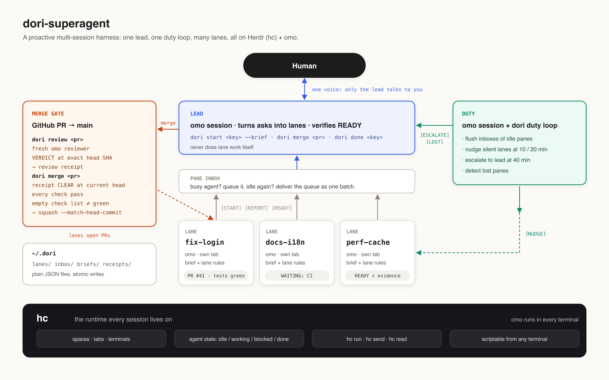
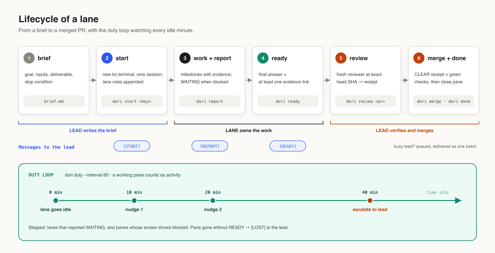

<p align="center">
  
</p>

# Dori

いつものチャットにいる、24時間365日働くエンジニアです。

[English](README.md) | [简体中文](README.zh.md) | [Deutsch](README.de.md) | 日本語 | [Italiano](README.it.md)

[](https://github.com/sisyphuslabs/dori-superagent/actions/workflows/ci.yml)
[](LICENSE)

DoriはSlack、Discord、Telegramに住んでいます。スレッドでやってほしいことを書くと、Doriはその仕事専用のコーディングエージェントのセッションを用意し、作業が完了したと証明できた時点で返信します。証明とは、マージされたPR、クローズされたissue、公開されたバージョンのことです。依頼がない間は、Doriが次のタスクを自分で見つけます。仕組みはこれだけです。

このリポジトリ `dori-superagent` は、Sustainable Use Licenseで公開しているDoriです。Dori mode（`skills/dori-mode`）は、あなたが話しかけるボットです。コーディングエージェント用のスキルと `dori` CLIで構成されていて、CLIは作業するセッションを開き、追跡し、閉じます。Slack、Discord、Telegramとのやり取りもこのCLIが担います。

ハーネス（`src/`）はDoriの裏側にある機械室です。リードセッション（lead）がひとつ、当番ループ（duty loop）、毎時ループ（hourly loop）、ホストが支えられる数だけのレーン（lane）、そしてマージゲートで構成されます。[Bun](https://bun.sh) 上のTypeScript約4,600行で、ランタイム依存はありません。セッションが動くターミナルランタイムの [herdr](https://github.com/herdrdev/herdr)（または同じプロジェクトの画面なし版であるhc、herdr-core）と、GitHubで70.8kスターを持つコーディングエージェントの [omo](https://github.com/code-yeongyu/oh-my-openagent) の上で動きます。

## できること

- スレッドに書き込むと、Doriはメッセージに「eyes」のリアクションを付け、1分以内に返答します。仕事が動いている間、状況はひとつのメッセージにまとまり、Doriがその場で編集していきます。15分ごとと各マイルストーンで短い進捗メモが入ります。
- 仕事はそれぞれ専用のherdrタブで動き、起動からクローズまでレジストリに記録されます。同時に動かせる数はホストが支えられる分だけです。メモリ、ディスク、ペイン数がしきい値を超えると、ホストガードが新しい起動を保留します。
- 証明のない「完了」はありません。レーンは証拠付きで完了を申告し、その申告は実際の状態と照合されます。PRがマージされている、issueがクローズされている、バージョンがnpmにある、コマンドが通る、URLが応答する、といった確認です。成り立たない申告は5分以内に未完了として差し戻され、プッシュしていない作業が残るレーンはクローズできません。
- 通知が来るのはマージのときだけです。あなたと話すのはリードだけで、コード変更はマージ後にPRとマージコミット付きで報告します。レーンと当番ループがあなたに話しかけることはありません。
- 不在の間も仕事は進みます。ブリーフ（brief）はバックログで待機します。1時間に1回、ループが終わった項目を片付け、誰も閉じなかった項目を監査し、判断の要らない次の項目を始め、未解決の質問をそれぞれ1回だけあなたに尋ねます。
- 仕事ごとに専用のスレッドかTelegramのトピックが作られ、状態付きの名前（`[working]`、`[waiting]`、`[done]`）が付きます。完了するとアーカイブされ、そこに再び書き込むと再オープンされます。
- ボイスメッセージは、設定した音声認識コマンドで文字起こしされ、テキストと同じように扱われます。
- 再起動しても何も失われません。依頼の作業ログ、各レーンのチェックポイント、レジストリはディスク上にあり、Doriが自分の記憶を信用する前に `dori boot` がそれらを読み戻します。
- Doriはスレッドの言語で返信し、あなたの書き方に合わせ、メッセージを短く保ち、絵文字を使いません。

## Doriの住む場所

Slack、Discord、Telegramは `skills/dori-mode/scripts/src/messenger/` に実装されています。表は現時点でそれぞれができることの一覧です。表にないことはコードもしません。

| | Slack | Discord | Telegram |
|---|---|---|---|
| 投稿とその場での編集 | 対応、スレッドへの返信も可能 | 対応、本文中のメンションで誰かに通知が飛ぶことはありません | 対応、プレーンテキストか表付きのHTML |
| スレッド | Slackのスレッド | スレッドの作成、名前変更、アーカイブ | フォーラムのトピック: 作成、名前変更、クローズ、再オープン |
| 入力中表示とストリーミング | | 入力中インジケーター | 入力中インジケーターと、回答を書く間に伸びていく下書き（最初は "Thinking…"） |
| 受信、あなたのメッセージの届き方 | `dori inbound slack`: スレッドビュー、Doriが投稿したすべてのスレッド（タグの有無を問わず）、未読のDM、グループDM、メンション | 使っているメッセンジャーツールの監視機能 | `dori inbound telegram`: オーナーのメッセージ、DM、ひとつのグループ（`DORI_TELEGRAM_TOPIC_ID` を設定した場合はそのトピックひとつ）だけを通すロングポーリング。編集も含み、メディアはファイルIDで届きます |
| プレゼンス | `dori presence slack` がメンバーアカウントをオンライン表示に保ちます | `dori presence discord` がゲートウェイにオンラインとして接続します | |
| ファイル | ライブラリからアップロード | | 受信メディアのファイルID |
| トークン | `DORI_SLACK_TOKEN`、ユーザートークンの場合は `DORI_SLACK_COOKIE` も | `DORI_DISCORD_TOKEN` | `DORI_TELEGRAM_TOKEN`、`DORI_TELEGRAM_OWNER_ID`、必要に応じて `DORI_TELEGRAM_GROUP_ID` と `DORI_TELEGRAM_TOPIC_ID` |

Slackでは、Doriをどう見せるかをセットアップ時に選びます。ユーザートークンならDoriは本物のメンバーです。有料のシートを使い、そのメンバーが見えるものはすべて見え、緑のオンライン表示も保てます。ボットトークンならDoriはアプリです。シートは不要で、招待されたチャンネルだけを、付与したスコープの範囲で扱います。

ボットの作成とログインの仕上げは [agent-messenger](https://github.com/agent-messenger/agent-messenger) で行います。表のヘルパーは各プラットフォームのAPIを直接呼び、レート制限にはサーバーが示す待ち時間で再試行し、`$(` を含むテキストは拒否します。メッセージ本文はデータであって、シェルを通ることはないからです。どのプラットフォームでも、`dori transcribe` は `hooks.transcribe` に設定したコマンドでボイスメモをテキストに変換します。このリポジトリはTeams、WhatsApp、LINE、WeChat、iMessage、KakaoTalk、Larkには対応しておらず、`dori send` は知らないチャンネルを拒否します。

`dori send <slack|telegram|discord> --to TARGET --text TEXT [--thread ID] [--edit ID]` で、シェルからメッセージを投稿または編集できます。同じクラス（`Slack`、`Discord`、`Telegram`）はインポート可能なモジュールでもあり、HTTPクライアントと時計を引数で受け取ります（タイピングとプレゼンスのヘルパーがタイマーを受け取ります）。テストがネットワークなしで動くのはこのためです。

## クイックスタート

どちらのインストールも `dori` という名前のコマンドをPATHに置くので、1台のマシンにはどちらか一方を入れてください。両方を入れたマシンでは、ハーネスを `bun src/cli.ts` として実行し、`dori` はDori modeに任せます。ハーネス自身のプロンプトは、どちらの場合もフルパスで呼び出します。

### Dori mode、あなたが話しかけるボット

herdr、Bun 1.4.5以降、git、GitHub CLIの `gh` が必要です。

```sh
curl -fsSL https://raw.githubusercontent.com/sisyphuslabs/dori-superagent/main/install.sh | bash
```

これでこのリポジトリが `~/.dori/src` にクローンされ、スキルが `~/.agents/skills/dori-mode` にリンクされ、`dori` がPATHにリンクされ、設定例が `~/.dori/config.json` にコピーされます。少なくとも `leadPane`（`herdr pane current` で確認できる自分のherdrペイン）、`laneWorkspace`、`defaultCwd` は編集してください。

次に、herdrの中でコーディングエージェントを起動し、「Dori mode」と伝えます。エージェントは呼び名を尋ね（ただのDori、あるいはShipDori、WorkDoriなど。複数を並べて動かせます）、使うメッセンジャーを尋ね、ボットの作成とログインをあなたと一緒に仕上げ、ボット経由で挨拶します。あなたのものを読む前に、ツールごとに許可を求めます。このオンボーディングは読み取り専用です。

運用の取り決めは [`skills/dori-mode/SKILL.md`](skills/dori-mode/SKILL.md) にあります。セットアップ、セッション、完了プロトコル、全コマンドは [`references/`](skills/dori-mode/references/) にまとまっています。

### ハーネス

Bun 1.4.5以降、herdr、omo、`gh`（PRのhead SHA、チェック、マージに使います）が必要です。

```sh
git clone https://github.com/sisyphuslabs/dori-superagent
cd dori-superagent
bun install
bun link   # puts `dori` on your PATH
```

herdrを起動してから、次を実行します。

```sh
dori up
# UP runtime=herdr lead=w1:p1 duty=w1:p2 loop=w1:p3 hourly=w1:p4 home=~/.dori
```

これで `dori` という名前のherdrワークスペースが開きます。中身はリードペイン（システムプロンプトに `prompts/lead.md` を追加したomo）、当番ペイン（`prompts/duty.md` 付きのomo）、その下の当番ループ、さらにその下の毎時ループです。話しかけるのはリードペインです。リードはブリーフ（目標、入力、成果物、停止条件、制約。[`examples/brief.md`](examples/brief.md) を参照）を書き、自分でレーンを開きます。同じことはシェルからもできます。

```sh
dori start fix-flaky-login --brief examples/brief.md
# STARTED fix-flaky-login pane=w1:p5 brief=~/.dori/briefs/fix-flaky-login.md
dori status
```

レーンの中では、omoがレーンルールで渡されたコマンドを使って報告し、作業を終えます。

```sh
dori report fix-flaky-login --text 'reproduced: 1 failure in 20 runs, shared session fixture'
dori report fix-flaky-login --status waiting --text 'WAITING: checks on owner/repo#12'
dori ready fix-flaky-login --text 'root cause fixed in owner/repo#12, checks green' --evidence https://github.com/owner/repo/pull/12
```

`[READY fix-flaky-login]` を受け取ったリードは、次を実行します。

```sh
dori review owner/repo#12            # fresh omo reviewer pinned to the head SHA; writes a receipt; exit 0 on CLEAR
dori merge owner/repo#12 --dry-run   # MERGE_OK ... (dry run), or MERGE_REFUSED <why> with exit 2
dori merge owner/repo#12             # gh pr merge --squash --match-head-commit <sha>
dori done fix-flaky-login            # closes the lane's pane; only a READY lane can be closed
```

引数なしで `bun src/cli.ts` を実行すると、すべてのコマンドとそのフラグが表示されます。

## ハーネスの仕組み



役割は3つあり、それぞれがherdrペイン内のomoセッションです。herdrはワークスペース、タブ、ペインを提供し、ペイン内のomoをエージェントとして認識し、その状態（idle、working、blocked、done）をCLIで報告します。doriはペインに何かをする前に、必ずその状態を読みます。

あなたと話すのはリードだけです。リードは依頼をブリーフにし、`dori start` でレーンを開き、レーンから返ってきたものを読み、マージします。

レーンは専用のherdrタブで動くomoセッションで、ブリーフひとつと、それに追加されたレーンルール（`prompts/lane-footer.md`）で起動します。マイルストーンは `dori report` で報告し、`dori ready` で終えます。`dori ready` は証拠リンクがないと送信しません。

当番ループは `dori duty --interval 60` で、当番omoセッションの隣のペインで動く普通のプロセスです。毎ティック、キューに溜まったメッセージをアイドルになったペインへ流し、黙っているレーンを促し、リードにエスカレーションし、ペインが消えたレーンを失われたものとして記録します。`dori duty stop --text 'why'` が停止スイッチで、`dori duty resume` するまで各ティックは停止中の理由を表示するだけです。

毎時ループは `dori loop` で、`dori up` が4つ目のペインで起動します。仕事は `~/.dori/backlog/` 以下のバックログで待機し、1項目にブリーフがひとつです。項目はリードが追加するか、ラベル付きのGitHub issueから取り込みます。

```sh
dori backlog add search-index --brief briefs/search.md --priority 2
dori backlog add new-billing --brief briefs/billing.md --decision 'charge per seat or per workspace?'
dori backlog import owner/repo --label dori     # label p1..p9 sets the priority, needs-decision marks a question
```

ゲート（停止されていない、別のループにロックされていない、前回の実行から少なくとも1インターバル経っている）を通過した実行は、まず項目をレーンとPRの状態に同期させます。次に、取りこぼした仕事を監査します。3時間黙っているレーン、2時間誰も閉じていないREADYのレーン、消えたペインです。それから、ホストの負荷とメモリに余裕がある間、開いているレーン数 `--max-lanes`（デフォルト3）と1回あたりの開始数 `--max-starts`（デフォルト2）の範囲で、次の未着手項目を取り出します。未解決の質問はそれぞれ `[DECIDE <id>]` として1回だけリードに届き、6時間後に1度だけリマインドされます。実行の最後には、リードへの `[LOOP ...]` 報告が1件送られます。

ループがするのはレーンを開くこととメッセージを送ることだけです。マージ、プッシュ、ペインのクローズは決してしません。設計の全体は [`docs/hourly-loop.md`](docs/hourly-loop.md) にあります。



`dori start <key> --brief FILE` は、ブリーフとレーンルールを `~/.dori/briefs/<key>.md` に書き、タブを開き、そのブリーフを名指ししたプロンプトでomoを起動し、レーンを `working` として記録し、リードに `[START <key>]` を送ります。そこからレーンは報告を送り（`[REPORT <key>]`、自分のペインの外で止まっているときは `[REPORT <key> WAITING]`）、最後に `[READY <key>]` と証拠リンクで終わります。アイドルのままのレーンには10分と20分で促しが入り、40分でリードにエスカレーションされます。READYの前にペインが消えたレーンは `[LOST <key>]` として報告されます。

状態は `~/.dori`（または `$DORI_HOME`）以下のディスク上のJSONです。`lanes/`、`inbox/`、`briefs/`、`receipts/` に加え、毎時ループ用の `backlog/` と `loop/`、当番ループの停止ファイル用の `duty/` があります。エージェントセッション以外にハーネスが追加する常駐プロセスは2つのループだけで、ランタイム依存はBunだけです。

### 2つのセッションランタイム

セッションはherdrかhc（[herdr-core](https://releases.herdr.dev/core/install.sh)）の上で動き、ひとつのホームに両方のセッションを置けます。ハーネスは `src/runtime/` のひとつのインターフェースを通してそれらと話し、保存されたレーンと役割はどのランタイムが自分を開いたかを覚えているので、どちらが選ばれていてもコマンドは正しい側に届きます。新しいセッションは `DORI_RUNTIME` が名指すランタイム、なければ `$DORI_HOME/config.json` の `"runtime": "herdr"` か `"runtime": "hc"` で開きます。どちらも設定がなければ、hcのターミナル内ではhc、herdrのペイン内ではherdr、それ以外ではhcが入っていればhc、なければherdrをDoriが選びます。hcが既定のランタイムで、どちらもPATHにない場合だけ、1行の直し方を添えて拒否します。`dori status` はその選択を最初に `RUNTIME hc (from config)` のように表示します。

hcにはワークスペースもタブもありません。Doriはセッションごとにラベル付きのターミナルをひとつ開き、セッションの状態はエージェント自身の報告（最近のomoビルドが送るOSC 7501シーケンス）だけから得ます。一度も報告しないエージェントは `unknown` のままで、宛てたメッセージはインボックスで待ちます。`dori migrate --to hc --all`（または `--lane <key>`、`--role duty-loop`、計画だけ見るなら `--dry-run`）はセッションをもう一方のランタイムへ移します。引き継ぎブリーフを取り、代わりのセッションを開き、インボックスを移し、古いセッションを閉じて、セッションごとに `MIGRATED`、`SKIP`、`DEFERRED`、`MIGRATE_ROLLBACK` のいずれかを表示します。動詞ごとの対応は [`docs/runtime.md`](docs/runtime.md) にあります。

## ハーネスが守らせること

### 話す口はひとつ

あなたと話すセッションはリードだけです（`prompts/lead.md`）。レーンルールは、あなた宛ての事実をすべてリードに送らせます（`prompts/lane-footer.md`、ルール3）。当番セッションはマージもせず、あなたに話しかけることもありません（`prompts/duty.md`）。

### READYには証拠が必要

`dori ready` は、`--evidence` リンクが1つ以上なければ、また最終回答のテキストがなければ拒否します。どちらもレーンの記録に保存され、`dori done` は `ready` でないレーンを拒否します。記録された回答なしに閉じるレーンはありません。

### 作業中のペインは邪魔されず、二重送信もない

`dori send` はまずherdrにペインのエージェント状態を尋ねます。`idle` か `done` ならメッセージはすぐ届きます。それ以外の状態なら `~/.dori/inbox/` のキューに入り、ペインがアイドルになったときに当番ループがまとめて1回で届けます。シェルが前面にあるペインには決して入力しません。入力したテキストがコマンドとして実行されてしまうからです。

テキストがすでにペインに届いた可能性があるあとで配信が失敗した場合は、後でEnterだけを押します。それも、テキストを入力したのと同じエージェントに対してだけです。herdrが別のエージェントを検出した場合、そのエントリは保留され、`[DELIVERY-AMBIGUOUS <pane>]` でリードに1回だけ伝えられ、`dori inbox ack` か `dori inbox resend` で手動で決着させます。

### 10分、20分、40分の促し

10分間報告がなく、ペインも作業中でないレーンには、ペインに `prompts/nudge.md` が送られます。20分でもう一度送られ、40分になると当番ループがリードに `[ESCALATE <key>]` を送ります。`--status waiting` を報告したレーンや、ペインが `blocked` のレーンには手を出しません。

### マージには正確なheadでのCLEARレシートと緑のチェックが必要

`dori merge` は `gh` でPRのhead SHAを読み、そのSHAに対する判定 `CLEAR` のレシート（receipt）が `~/.dori/receipts/` にあることを求めます。レシートを書くのは `dori review` だけです。`dori review` はそのSHAに固定した新しい非対話のomoを `prompts/review.md` で実行し、レビュアーが `VERDICT:` 行を出力しなければレシートは書かれません。

次に、`gh pr checks` が少なくとも1つのチェックを返し、すべてのチェックが `pass` か `skipping` で、少なくとも1つが `pass` である必要があります。チェック一覧が空なら "an empty check list is never green" として拒否されます。レビュー後にプッシュするとhead SHAが変わるので、レシートが一致しなくなり、`dori review` をもう一度実行する必要があります。

### 自前のツール用のフック

`$DORI_HOME/config.json` の `hooks` 以下に、argvテンプレートを指定できます。`onReady`、`onReport`、`onLost` はそれぞれのイベントでバックグラウンド実行され、引数ごとに `{key}`、`{text}`、`{evidence}` が埋め込まれます。`reviewCommand` は、同じ `VERDICT:` 行を出力する限り、組み込みのレビュアーの代わりになります。`DORI_PROMPTS_DIR` を使うと、ハーネスが自分用にコピーしたプロンプトを使うようになります。

## Dori modeの詳細

### 振り分け

質問、状況確認、調べもの、小さな編集はDori自身のセッションで処理します。PRとして入るコード、複数ステップの作業、長い仕事や並列の仕事にはレーンが割り当てられます。そのリポジトリやトピックを担当するアイドルのレーンがすでにあれば、仕事はそこへ回ります。`dori can-launch` が `HOLD`（メモリ、ディスク、ペイン数のいずれかがガードのしきい値を超過）を返したら何も開かず、その理由といつ始まるかがあなたに伝えられます。

### 完了は事実ではなく申告

`dori launch` が `Done =` 行を受け付けるのは、ウォッチャーがすべてのシグナルを自分で読み戻せる場合だけです。シグナルは `;` でつなぎ、すべてが通ったときにレーンは完了になります。

| シグナル | 通る条件 |
|---|---|
| `merged <owner/repo>#N` | PRがマージされ、マージコミットがある |
| `closed <owner/repo>#N` | issueがクローズされている |
| `published <pkg>@<version>` | npmにそのバージョンがそのままある |
| `command ["argv","as","json"] [stdout~"regex"]` | コマンドが終了コード0で終わり、正規表現が指定されていればstdoutがそれに一致する |
| `file <path> [sha256=<hex>] [json:.a.b=<value>]` | ファイルが存在し、sha256が一致し、JSONのフィールドが値と等しい |
| `url <http(s) url> [status=200] [body~"regex"]` | GETがそのステータスを返し、正規表現が指定されていれば本文がそれに一致する |

レーンは `dori claim-done <key> --evidence "..."` で完了を申告します。`dori watch` は5分以上経った申告を決着させます。プッシュやコミットをしていない作業と、通らないシグナルは異議になります。それ以外はレーンがクローズされ、スレッドフックが設定されていればスレッドが完了扱いになり、タブが閉じられ、ワークツリーが削除されます。

### PRを完了と呼ぶ前に

`dori verify-pr <owner/repo> <num>` は `gh api` でPRを読み、すべてのコミットの作者とコミッターのメールアドレスがそのリポジトリに設定されたアイデンティティであること、ソースに触れる `fix:` コミットに変更されたテストか `No test:` の理由が付いていることを確認します。

### 教訓

`dori lesson add` は、レーンがあるリポジトリについて学んだルールを、それを教えた証拠と結び付けて記録します。`--global` の教訓は、リードがすべてのレーンに課す恒久的なルールです。`dori launch` は、現在有効な教訓を次のブリーフの上に置きます。

### 監督

`freshness` のティックごとに、起動したレーンを、経過分数、トークン数、コスト（設定した使用量コマンドから取得）の任意の上限と照らし合わせます。新しい報告、チェックポイント、ファイル変更がないまま `Working` タイマーが20分伸び続けたレーンは、停滞として記録します。上限に達したレーンが強制終了されることはなく、リードを待ちます。

### 待ってと言ったとき

`dori pause <key>` はレーンの目標を一時停止し、実行中のターンを止めます。一時停止を確認できなかった場合は `PAUSE_UNVERIFIED` を表示します。`dori resume <key>` で再開します。

## 同じ構造、同じ哲学

DeepSeekは [dsh-superagent-prototype](https://github.com/deepseek-ai/dsh-superagent-prototype)（最初のコミットは2026-10-31）を公開し、その約1日後に記事「Exploring Super-agent Design: Towards a More Autonomous Agent System」を出しました。そのドキュメントをDoriと並べると、パイプラインでも、[哲学ドキュメント](https://github.com/deepseek-ai/dsh-superagent-prototype/blob/main/docs/000-philosophy.md)のルールでも、概念が一対一で対応します。


| DeepSeek dsh-superagent | Dori |
|---|---|
| ソース: GitHub、Feishu | Doriはチャットに住む: Slack、Discord、Telegram |
| トリガー、次に評価、次にチケット | チャットで頼まれたひとつのタスクが、ブリーフひとつのレーンひとつになる |
| チケットごとの実行セッション: セッションひとつ、作業ディレクトリひとつ | タスクごとにコーディングエージェントのセッションひとつ、専用のherdrタブで、多数を並列に |
| チャネル: 元の会話で答える、たとえばPR付きで | 同じスレッドで報告、タスクごとに状況メッセージひとつ、その場で編集 |
| パネル: 人が必要なものだけを表示 | リードがあなたに尋ねるのは、取り消せない判断かプロダクトを変える判断だけ |
| 人の注意は最小、価値は最大 | 短いメッセージ、絵文字なし、通知はマージ後だけ |
| 頼まれたとき、または書かれたチームルールが許すときだけ動く | Doriは誰も頼んでいない仕事を始めない。バックログにあるのはあなたが積んだもの |
| 人が動く必要があるときだけ、一度にひとつ質問する | 判断は番号付きの選択肢と、Dori自身の推奨で届く |
| 正直に報告し、障害を回避してごまかさない | 証明のない「完了」はなく、障害は障害として報告される |

私たちはこの形を約6か月、公開の場で運用してきました。

- 2026-04-18: omoにチームモードが入り、複数のエージェントセッションがターミナルペインでそれぞれワークツリーを持って動くようになります（[f1268c0](https://github.com/code-yeongyu/oh-my-openagent/commit/f1268c0)、[e303fee](https://github.com/code-yeongyu/oh-my-openagent/commit/e303fee)）。
- 2026-05-06: Doriの名前がomoのREADMEに登場します（[#3807](https://github.com/code-yeongyu/oh-my-openagent/pull/3807)）。
- 2026-10-07: このリポジトリがDori modeを `omo-dori-mode-experimental` として公開します（[ce53e4d](https://github.com/sisyphuslabs/dori-superagent/commit/ce53e4d)）。
- 2026-10-31: DeepSeekのプロトタイプが最初のコミットを迎えます。

omo自体もこの方法で作られています。2026-07-13から2026-11-08の間に、[code-yeongyu/oh-my-openagent](https://github.com/code-yeongyu/oh-my-openagent) は全コントリビューターを合わせて2,846件のプルリクエストをマージし、18,780件のコミットを取り込みました。いずれもこの仕組みの完全版で生み出したものです。このリポジトリのハーネスは最小版で、herdrとomoだけで動く部分です。

## 設定

ハーネスの環境変数:

| 変数 | デフォルト | 意味 |
|---|---|---|
| `DORI_HOME` | `~/.dori` | 状態ディレクトリ |
| `DORI_AGENT_CMD` | `omo` | 各ペインで動かすエージェント |
| `DORI_HERDR_SESSION` | | 名前付きのherdrセッション |
| `DORI_RUNTIME` | いま自分がいるランタイム、なければPATHにある `hc`、それもなければ `herdr` | 新しいセッションをどのランタイムで開くか。`herdr` か、`hc`（herdr-core、同じプロジェクトの画面なしのセッションランタイム）です。`$DORI_HOME/config.json` の `runtime` キーも同じ働きをします。どちらもPATHになく、何も設定されておらず、どちらのペインやターミナルの中でもなければ、`dori` は1行の直し方を添えて拒否します |
| `DORI_CMD` | `src/cli.ts` へのフルパス | エージェントにdoriをどう呼ばせるか |
| `DORI_PROMPTS_DIR` | リポジトリの `prompts/` | 自分用のプロンプトファイル |
| `DORI_MAX_LANES`, `DORI_MAX_STARTS`, `DORI_MAX_LOAD` | 3、2、コア数 | 毎時ループの予算 |
| `DORI_TELEMETRY`, `DORI_TELEMETRY_ENDPOINT` | オン、`https://t.omo.dev` | `0` でテレメトリーをオフ |

Dori modeは `~/.dori/config.json`（または `DORI_CONFIG`）を読みます。フィールドはすべて任意で、[`config.example.json`](skills/dori-mode/references/config.example.json) に全項目があります。最初に設定することになるのは次のものです。`leadPane`、`laneWorkspace`、`defaultCwd`、`agentCommand` と `defaultModel`、`repoIdentities`（`verify-pr` がリポジトリごとに期待するGitの名前とメールアドレス）、`hooks.threadReply` と `hooks.threadDone`（`{thread}` と `{text}` を含むargvテンプレートとして書く、使っているメッセンジャーのCLI）、`hooks.transcribe`、そして `guard`（負荷、空きメモリ、空きディスク、ペイン数）です。タイミングのデフォルトは、静かな状態が15分続いたら促し、20分で最後の報告をスレッドに投稿、完了申告は5分で決着です。

## コンテナで動かす

[`examples/container/`](examples/container/) には、gh、node、bun、herdr、agent-messenger、omo、ハーネスを入れた長時間動くコンテナ1つ分のDockerfile、composeファイル、エントリポイントがあります。ダウンロードするバイナリはすべて固定したsha256で検証し、npmパッケージとハーネスはバージョンとコミットで固定しています。イメージは公開していません。自分でビルドし、動いているコンテナの中で一度だけログインを済ませれば、名前付きボリュームがそれを保持します。ビルド、初回の実行、アタッチの方法は [`docs/container.md`](docs/container.md) にあります。

## テレメトリー

doriはomoと同じ方法で匿名の利用カウントを送ります。OTLP/HTTPのJSONログを、`https://t.omo.dev` のomoコレクターへ送る形です。識別子は `~/.dori/telemetry.json` に保存されるランダムなインストールIDで、送られるのはそのsha256だけです。最初の送信時に、コレクターがそのハッシュからインストールごとの取り込みキーを発行します。共有キーはコードに含まれていません。初回実行時に1行の通知が表示されます。`DORI_TELEMETRY=0` でオフにできます（`DO_NOT_TRACK=1` も使えます）。

| イベント | タイミング | フィールド |
|---|---|---|
| `dori.installed` | 初回実行 | なし |
| `dori.daily_active` | UTCで1日1回、任意のdoriコマンドで | `day_utc` |
| `dori.lane_started` | `dori start` | `open_lanes` |
| `dori.lane_ready` | `dori ready` | `evidence_count`, `lane_minutes` |
| `dori.review_completed` | `dori review` | `verdict`: `CLEAR` または `BLOCK` |
| `dori.merge_decided` | `--dry-run` なしの `dori merge` | `outcome` |
| `dori.duty_summary` | 当番ループから、最大で1時間に1回 | `ticks`, `flushed`, `nudges`, `escalations`, `lost` |

どのレコードにも、サービス名とバージョン、インストールハッシュ、CIフラグ、OSの種類とバージョン、CPUアーキテクチャが含まれます。パス、リポジトリ名、PR番号、レーンキー、ブリーフ、メッセージ、その他のテキストは一切送りません。コマンドが送信を待つのは最大2秒で、テレメトリーの失敗でコマンドが失敗することはありません。

## テストと開発

```sh
bun test ./test/                                  # the harness: 386 tests across 42 files, no model calls
cd skills/dori-mode/scripts && bun install && bun test   # Dori mode: 321 tests across 44 files
bun run ci                                        # biome, tsc, knip, the 250-line check, both suites
```

ハーネスのテストは、偽のherdr、偽のhc、偽のgh、テストが進める時計を相手に動きます。エンドツーエンドテストは、隔離したセッションで本物のherdrサーバーか本物のhcコアを起動し、omoの代わりに偽のエージェントスクリプトを使います。それぞれのバイナリがPATHになければ自分でスキップします。Dori modeのテストは偽のherdr、git、ghを相手に動き、本物には何も触れません。CIはUbuntuとmacOSで同じものを実行します。

## これが何でないか

ハーネスは最小版で、私たちの本番スタックではありません。意図して外したものは、マシンをまたぐメッシュ、重いスロットのスケジューリング、チャットとチケットトラッカーのブリッジ、テストスイート全体に対するレシートです。herdrとomoだけで動く部分はここにあります。役割、レーン、インボックス、当番ループ、毎時ループとバックログ、レビューとマージのゲートです。Dori modeは独自のメッセンジャー部品、ホストガード、重いスロットのランナーを持つ別のCLIで、ハーネスはそこから何もインポートしません。

## コントリビュート

コントリビューターは最初のプルリクエストに `I have read the CLA Document and I hereby sign the CLA` とコメントして、[Contributor License Agreement](CLA.md) に一度だけ署名します。CLA Assistantのチェックがそれを記録します。ゲート、テストコマンド、プルリクエストのルールは [CONTRIBUTING.md](CONTRIBUTING.md) にあります。

## ライセンス

[Sustainable Use License](LICENSE) バージョン1.0です。omoと同じライセンスで、サードパーティのコンポーネントはそれぞれのライセンスに従います。自社内での業務利用と、非商用または個人での利用を対象とし、商用利用には所有者のライセンスが必要です。`ba96abf` より前のコミットはMITライセンスで公開されています。
