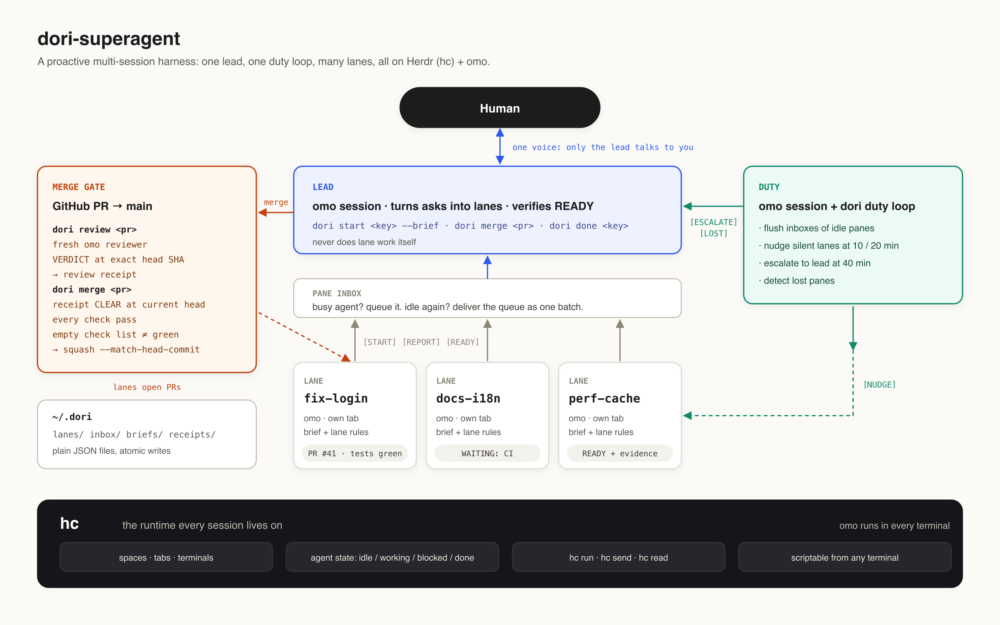
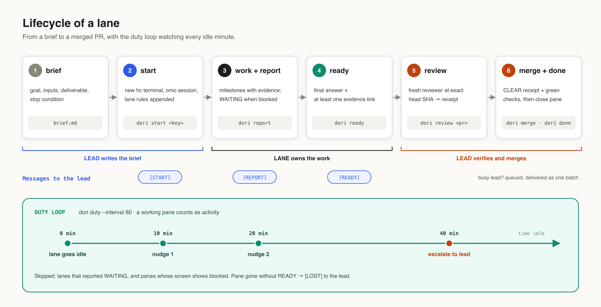

<p align="center">
  
</p>

# Dori

Your 24/7 engineer, in the chat you already use.

English | [简体中文](README.zh.md) | [Deutsch](README.de.md) | [日本語](README.ja.md) | [Italiano](README.it.md)

[](https://github.com/sisyphuslabs/dori-superagent/actions/workflows/ci.yml)
[](LICENSE)

Dori lives in your Slack, Discord or Telegram. You tell him what to do in a thread, he gives the job its own coding-agent session, and he writes back when the work is proven done: a merged PR, a closed issue, a published version. Between requests he finds the next task himself. That's the whole setup.

This repository, `dori-superagent`, is Dori under the Sustainable Use License. Dori mode (`skills/dori-mode`) is the bot you talk to: a skill for your coding agent plus a `dori` CLI that opens, tracks and closes the sessions doing the work, and talks to Slack, Discord and Telegram.

The harness (`src/`) is the machine room behind him: one lead session, a duty loop, an hourly loop, as many lanes as the host carries, and a merge gate, in about 4,600 lines of TypeScript on [Bun](https://bun.sh) with no runtime dependencies. It runs on hc ([herdr-core](https://releases.herdr.dev/core/install.sh)), the terminal runtime the sessions live in, shown as tabs in the Herdr app, and [omo](https://github.com/code-yeongyu/oh-my-openagent), the coding agent, which has 70.8k stars on GitHub.

## What you get

- You write in a thread. Dori marks the message with an "eyes" reaction, answers within a minute, and while a job runs its status is one message that he edits in place, with a short progress note every 15 minutes and at each milestone.
- Every job runs in its own terminal, a tab in the Herdr app, recorded in a registry from launch to close, as many at once as the host carries. A host guard holds new launches when memory, disk or the pane count cross its line.
- No "done" without proof. A lane claims done with evidence, and the claim is checked against live state: the PR is merged, the issue is closed, the version is on npm, the command passes, the URL answers. A claim that doesn't hold goes back as not done within 5 minutes, and a lane with unpushed work can't close.
- Only the merge gets a ping. The lead is the only session that talks to you, and it reports a code change after the merge, with the PR and the merge commit. Lanes and the duty loop never talk to you.
- Work goes on while you're away. Briefs wait in a backlog. Once an hour the loop retires finished items, audits the ones nobody closed, starts the next ones that need no decision, and asks you each open question once.
- Each job gets its own thread or Telegram topic, named with its state (`[working]`, `[waiting]`, `[done]`), archived when it's done and reopened when you write in it again.
- A voice message is transcribed through your speech-to-text command and handled like text.
- Nothing is lost on a restart. The worklog of your requests, each lane's checkpoints and the registry live on disk, and `dori boot` reads them back before the Dori trusts what it remembers.
- He replies in the language of the thread, matches how you write, keeps messages short, and uses no emojis.

## Where Dori lives

Slack, Discord and Telegram are implemented in `skills/dori-mode/scripts/src/messenger/`. The table lists what each one does today; what isn't on it, the code doesn't do.

| | Slack | Discord | Telegram |
|---|---|---|---|
| Post and edit in place | Yes, and reply in threads | Yes; mentions in the text never ping anyone | Yes, plain or HTML with tables |
| Threads | Slack threads | Start, rename and archive threads | Forum topics: create, rename, close, reopen |
| Typing and streaming | | Typing indicator | Typing indicator, and a draft that grows while the answer is written, starting as "Thinking…" |
| Inbound, how your messages arrive | `dori inbound slack`: the Threads view, every thread the Dori posted in (tagged or not), and unread DMs, group DMs and mentions | Your messenger tooling's watch | `dori inbound telegram`: a long poll that passes only the owner's messages, DMs and one group (one topic of it when `DORI_TELEGRAM_TOPIC_ID` is set), edits included, media as file ids |
| Presence | `dori presence slack` keeps a member account shown online | `dori presence discord` identifies on the gateway as online | |
| Files | Upload from the library | | File ids on inbound media |
| Tokens | `DORI_SLACK_TOKEN`, plus `DORI_SLACK_COOKIE` for a user token | `DORI_DISCORD_TOKEN` | `DORI_TELEGRAM_TOKEN`, `DORI_TELEGRAM_OWNER_ID`, and optionally `DORI_TELEGRAM_GROUP_ID` and `DORI_TELEGRAM_TOPIC_ID` |

On Slack you choose at setup how Dori appears. With a user token he is a real member: a paid seat, he sees everything that member sees, and he can hold a green online dot. With a bot token he is an app: no seat, only the channels he is invited to, within the scopes you grant.

Creating the bot and finishing its login goes through [agent-messenger](https://github.com/agent-messenger/agent-messenger). The helpers in the table call each platform's API directly, retry rate limits with the server's wait time, and refuse any text containing `$(`, since message text is data and never passes through a shell. On every platform, `dori transcribe` turns a voice note into text through the command you configure as `hooks.transcribe`. There is no Teams, WhatsApp, LINE, WeChat, iMessage, KakaoTalk or Lark support in this repository, and `dori send` refuses a channel it does not know.

`dori send <slack|telegram|discord> --to TARGET --text TEXT [--thread ID] [--edit ID]` posts or edits a message from the shell. The same classes (`Slack`, `Discord`, `Telegram`) are importable modules that take their HTTP client and clock as arguments (the typing and presence helpers take timers), which is how the tests run without the network.

## Quick start

Both installs put a command named `dori` on your PATH, so install one per machine. On a machine with both, run the harness as `bun src/cli.ts` and leave `dori` to Dori mode; the harness's own prompts call it by its full path either way.

### Dori mode, the bot you talk to

You need hc (herdr-core), Bun 1.4.5 or newer, git, and the GitHub CLI `gh`.

```sh
curl -fsSL https://raw.githubusercontent.com/sisyphuslabs/dori-superagent/main/install.sh | bash
```

That installs [Doriterm](https://doriterm.com) first when the machine has none (its host and herdr-core, through `get.doriterm.com`; a machine with any Doriterm host keeps it, and `DORI_NO_DORITERM=1` skips the step), then clones this repository to `~/.dori/src`, links the skill into `~/.agents/skills/dori-mode`, links `dori` onto your PATH, and copies an example config to `~/.dori/config.json`. Edit at least `leadPane` (your own hc terminal address, from `echo $HC_TERMINAL_ID`), `laneWorkspace` and `defaultCwd`.

Then start your coding agent inside an hc terminal and tell it: Dori mode. It asks what to call it (plain Dori, or ShipDori, WorkDori, so several can run side by side), asks which messenger, finishes the bot's creation and login with you, and greets you through the bot. Before it reads anything of yours it asks for permission tool by tool, and that onboarding is read-only.

The operating contract is [`skills/dori-mode/SKILL.md`](skills/dori-mode/SKILL.md); setup, sessions, the done protocol and every command are in its [`references/`](skills/dori-mode/references/).

### The harness

You need Bun 1.4.5 or newer, hc (herdr-core), omo, and `gh` (for PR head SHAs, checks and the merge).

```sh
git clone https://github.com/sisyphuslabs/dori-superagent
cd dori-superagent
bun install
bun link   # puts `dori` on your PATH
```

From a terminal of the Herdr app:

```sh
dori up
# UP runtime=hc lead=t1 duty=t2 loop=t3 hourly=t4 home=~/.dori
```

That opens four hc terminals: the lead (omo with `prompts/lead.md` appended to its system prompt), duty (omo with `prompts/duty.md`), the duty loop and the hourly loop. They are tabs in the space of the terminal you started from, named `lead`, `duty`, `duty-loop` and `hourly-loop`. Talk to the lead. It writes a brief (goal, inputs, deliverable, stop condition, constraints; see [`examples/brief.md`](examples/brief.md)) and opens lanes itself. You can do the same from a shell:

```sh
dori start fix-flaky-login --brief examples/brief.md
# STARTED fix-flaky-login pane=t5 brief=~/.dori/briefs/fix-flaky-login.md
dori status
```

Inside the lane, omo reports and finishes with the commands its lane rules hand it:

```sh
dori report fix-flaky-login --text 'reproduced: 1 failure in 20 runs, shared session fixture'
dori report fix-flaky-login --status waiting --text 'WAITING: checks on owner/repo#12'
dori ready fix-flaky-login --text 'root cause fixed in owner/repo#12, checks green' --evidence https://github.com/owner/repo/pull/12
```

The lead, on `[READY fix-flaky-login]`:

```sh
dori review owner/repo#12            # fresh omo reviewer pinned to the head SHA; writes a receipt and keeps the full review; exit 0 on CLEAR
dori merge owner/repo#12 --dry-run   # MERGE_OK ... (dry run), or MERGE_REFUSED <why> with exit 2
dori merge owner/repo#12             # gh pr merge --squash --match-head-commit <sha>
dori done fix-flaky-login            # stops the lane's terminal; only a READY lane can be closed
dori done fix-flaky-login --abandon --note 'wedged, restarted as fix-flaky-login-2'   # closes one that never reported READY
```

`bun src/cli.ts` with no arguments prints every command with its flags.

## How the harness works



Three roles, each an omo session in an hc terminal. hc starts the terminals and reports each agent's state (idle, working, blocked, done, error) as the agent itself announces it; the Herdr app shows the terminals as tabs. dori reads that state before it does anything to a pane.

The lead is the only session that talks to you. It turns a request into a brief, opens a lane with `dori start`, reads what lanes send back, and merges.

A lane is one omo session in its own terminal, started with one brief and the lane rules appended to it (`prompts/lane-footer.md`). It reports milestones with `dori report` and finishes with `dori ready`, which does not send without an evidence link.

The duty loop is `dori duty --interval 60`, a plain process in a pane next to a duty omo session. Each tick it flushes queued messages into panes that have gone idle, nudges lanes that have been silent, escalates to the lead, marks a lane whose terminal finished or vanished as lost, and cleans up the terminal and tab of a lane that was closed 15 minutes ago. `dori duty stop --text 'why'` is its kill switch; until `dori duty resume`, every tick only prints why it is stopped.

The hourly loop is `dori loop`, started by `dori up` in a fourth pane. Work waits in a backlog under `~/.dori/backlog/`, one brief per item, added by the lead or imported from GitHub issues that carry a label:

```sh
dori backlog add search-index --brief briefs/search.md --priority 2
dori backlog add new-billing --brief briefs/billing.md --decision 'charge per seat or per workspace?'
dori backlog import owner/repo --label dori     # label p1..p9 sets the priority, needs-decision marks a question
```

A run that passes its gate (not stopped, not locked by another loop, at least an interval since the last run) first syncs items against lane and PR state. Then it audits missed work: a lane silent for 3 hours, a READY lane nobody closed for 2, a vanished pane. Then it pulls the next open items, within `--max-lanes` (default 3) open lanes and `--max-starts` (default 2) per run, while the host has load and memory to spare. Each open question reaches the lead once as `[DECIDE <id>]`, with one reminder after 6 hours, and the run ends with one `[LOOP ...]` report to the lead.

The loop only opens lanes and sends messages; it never merges, pushes or closes a pane. The full design is in [`docs/hourly-loop.md`](docs/hourly-loop.md).



`dori start <key> --brief FILE` writes the brief plus the lane rules to `~/.dori/briefs/<key>.md`, opens a tab, runs omo with a prompt that names the brief, records the lane as `working`, and sends the lead `[START <key>]`. From there the lane reports (`[REPORT <key>]`, or `[REPORT <key> WAITING]` when it is blocked outside its own pane) and ends with `[READY <key>]` plus its evidence links. A lane that stays idle gets a nudge at 10 and 20 minutes and is escalated to the lead at 40. A lane whose pane disappears before READY is reported as `[LOST <key>]`.

State is JSON on disk under `~/.dori` (or `$DORI_HOME`): `lanes/`, `inbox/`, `briefs/`, `receipts/`, plus `backlog/` and `loop/` for the hourly loop and `duty/` for the duty loop's stop file. Besides the agent sessions, the only long-running processes the harness adds are the two loops, and the only runtime dependency is Bun.

### The session runtime

Sessions run on hc ([herdr-core](https://releases.herdr.dev/core/install.sh)), and the harness talks to it through one interface in `src/runtime/`. `DORI_RUNTIME` and the `runtime` key in `$DORI_HOME/config.json` accept only `hc`. `dori status` prints where the choice came from first, as `RUNTIME hc (from config)`, and with no `hc` on PATH and nothing set, `dori` refuses with a one-line fix.

Dori opens one labelled terminal per session. A session's status comes only from the agent's own report (an OSC 7501 sequence, which recent omo builds send); an agent that never reports stays `unknown` and its messages wait in the inbox. hc's server does not inherit the caller's environment, so each new terminal is started with the caller's `DORI_*` settings and `PATH`.

Every terminal Dori opens joins one space of the Herdr app: the one `DORI_HERDR_SPACE` names (a `herdr.space` id, refused when no terminal is in that space), else the space of the terminal `dori` is started from. Its tab is then named through `herdr-app`: `lead`, `duty`, `duty-loop`, `hourly-loop`, or the lane key. The window lists a new terminal a moment after hc starts it, so the tab is looked up again, up to 10 times 200 ms apart, and a tab that cannot be named never fails the launch. `DORI_HERDR_APP` is the path of `herdr-app` when it is not on PATH. Started outside the Herdr app with no `DORI_HERDR_SPACE`, a terminal gets no placement. The details are in [`docs/runtime.md`](docs/runtime.md).

## What the harness enforces

### One voice

The lead is the only session that talks to you (`prompts/lead.md`). The lane rules send every fact meant for you to the lead (`prompts/lane-footer.md`, rule 3), and the duty session never merges and never talks to you (`prompts/duty.md`).

### READY needs evidence

`dori ready` refuses without at least one `--evidence` link and without final answer text. Both are stored on the lane record, and `dori done` refuses any lane that is not `ready`, so no lane closes without a recorded answer. The one way around is the lead's `dori done <key> --abandon --note 'why'`, for a lane that will never report READY: the note is kept in the lane's log instead.

### Busy panes are never interrupted, and nothing is sent twice

`dori send` asks hc for the pane's agent state first. `idle` or `done` get the message now; anything else has it queued in `~/.dori/inbox/`, and the duty loop delivers the queue when the pane goes idle, as one batch. A pane with a shell in front is never typed into, because typed text would run as a command.

hc pastes a message and presses Enter in one step, and refuses that step when the agent's state changed in between. When the step failed without saying whether the text arrived, the entry is held and never sent again by itself: the lead is told once with `[DELIVERY-AMBIGUOUS <pane>]`, and `dori inbox ack` or `dori inbox resend` settles it by hand.

### Nudges at 10, 20 and 40 minutes

A lane that has not reported for 10 minutes, and whose pane is not working, gets `prompts/nudge.md` in its pane, again at 20, and at 40 the duty loop sends the lead `[ESCALATE <key>]`. A lane that reported `--status waiting`, or whose pane is `blocked`, is left alone.

### A lane whose terminal ends is lost, and closed lanes are cleaned up

A lane whose hc terminal finishes or disappears before READY is marked `lost`, and the lead gets `[LOST <key>]`. `dori start` under that key records the loss first when the duty loop has not seen it yet, and then starts the lane afresh.

`DORI_TAB_CLOSE_MIN` minutes (default 15, `0` for never) after a lane is done or lost, the duty loop removes its terminal and closes its tab in the Herdr app. Until then `dori done` only stops the terminal, so its last screen can still be read. The duty loop touches only the terminal Dori started for that lane, never the lead's, duty's or a loop's, and keeps a tab that still holds another live terminal. A lane that is idle, waiting or READY is never cleaned up.

### Merge needs a CLEAR receipt at the exact head and green checks

`dori merge` reads the PR's head SHA with `gh`, then requires a receipt for that SHA in `~/.dori/receipts/` with verdict `CLEAR`. Only `dori review` writes receipts: it runs a fresh non-interactive omo on `prompts/review.md` pinned to that SHA. A run that prints no `VERDICT:` line is run once more, and after two such runs the review fails with no receipt. A run that takes longer than `DORI_REVIEW_TIMEOUT_MIN` minutes (default 25) is killed with its children and fails the review, unless it had already printed its verdict.

The reviewer's whole output is kept beside the receipt as `receipts/<pr>@<sha>.md`, also when the review fails; the receipt's `review` field is that path and its `summary` holds the start and the end of the review. Each run also leaves its stdout, stderr, result and session file in its own directory under `receipts/<pr>@<sha>.attempts/`.

For the built-in reviewer, `DORI_AGENT_CMD` accepts an executable followed by fixed arguments, with single quotes, double quotes and backslash escapes. A value that resolves as one executable is used as-is, including an unquoted path containing spaces. Otherwise, quote paths or arguments containing spaces, for example `DORI_AGENT_CMD='"/opt/lane tools/reviewer-omo" --account "review lane"'`. Review flags, including an explicit `--model`, follow those fixed arguments. The executable launches directly: variables, substitutions, globs and shell operators remain literal; use an executable wrapper for shell setup. Empty commands and malformed quoting are refused. `hooks.reviewCommand` retains precedence and uses its own argv template.

Then `gh pr checks` must return at least one check, every check must be `pass` or `skipping`, and at least one must be `pass`. An empty check list is refused with "an empty check list is never green". A push after the review changes the head SHA, so the receipt no longer matches and `dori review` has to run again.

Set `LANDING_BACKEND` to hand the PR to a landing queue instead of merging it:

```sh
export LANDING_BACKEND='["/absolute/path/to/landing-backend","submit"]'
dori merge owner/repo#123
```

The value is a JSON array, an executable and its literal arguments, parsed once at startup and never run through a shell. Dori re-reads the head, refuses one that moved, and calls the backend with `--repo owner/repo --pr 123 --expected-head FULL_SHA` appended. The backend must exit 0 and print one JSON object that repeats `repo`, `pr` and `expectedHead`. `"status":"queued"` prints `QUEUED owner/repo#123 head=FULL_SHA` and is admission only. `"status":"landed"` must carry a `landedHead` and a `landedTree` of 40 hexadecimal characters and a nonblank `receipt` naming the queue's own evidence, and prints `MERGED` with them. Any other answer is refused, with no fallback to a direct merge. `--dry-run` checks admission and never calls the backend.

`formaengine/forma-rs` lands only through its own queue: it needs `LANDING_BACKEND`, has no dry run, and its GitHub checks are not consulted, because the queue verifies the landing itself. When that backend runs Python, or when `FORMA_QUEUE_BOOTSTRAP` (a JSON object with `repo`, `pr`, `head` and `tree`) names the one PR head allowed to run from its own checkout, Dori checks the source before anything runs. The backend must be exactly `["python3", "/absolute/source/.agents/workflows/landing-verifier.py"]`, in a clean checkout of that repository at the pinned head and tree, or at freshly fetched `origin/main` when unpinned, with no symlink, bytecode or untracked importable file under `.agents/workflows` or `specs`. It then runs as `python3 -I -S -B <script>`.

### Hooks for your own tooling

`$DORI_HOME/config.json` may name argv templates under `hooks`: `onReady`, `onReport` and `onLost` run in the background when those events happen (with `{key}`, `{text}` and `{evidence}` filled in per argument), and `reviewCommand` replaces the built-in reviewer as long as it prints the same `VERDICT:` line. `DORI_PROMPTS_DIR` points the harness at your own copies of the prompts.

## Dori mode in depth

### Routing

A question, a status check, a lookup or a small edit is handled in the Dori's own session. Code that lands as a PR, multi-step work, or anything long or parallel gets a lane; if an idle lane already owns that repo or topic, the work goes there. If `dori can-launch` says `HOLD` (memory, disk or pane count over the guard's line), nothing opens and you are told why and when it will start.

### Done is a claim, not a fact

`dori launch` accepts a `Done =` line only when the watcher can read every signal back itself. Signals are joined with `;`, and the lane is done when all of them pass:

| Signal | Passes when |
|---|---|
| `merged <owner/repo>#N` | the PR is merged and has a merge commit |
| `closed <owner/repo>#N` | the issue is closed |
| `published <pkg>@<version>` | npm has that exact version |
| `command ["argv","as","json"] [stdout~"regex"]` | the command exits 0, and stdout matches the regex if one is given |
| `file <path> [sha256=<hex>] [json:.a.b=<value>]` | the file exists, its sha256 matches, and the JSON field equals the value |
| `url <http(s) url> [status=200] [body~"regex"]` | a GET returns that status, and the body matches if a regex is given |

A lane claims with `dori claim-done <key> --evidence "..."`. `dori watch` settles claims older than 5 minutes: unpushed or uncommitted work and failing signals turn into objections, and otherwise the lane is closed: its thread is marked done when a thread hook is configured, its tab is closed and its worktrees are removed.

### Before a PR is called done

`dori verify-pr <owner/repo> <num>` reads the PR through `gh api` and checks that every commit's author and committer email is the identity configured for that repo, and that `fix:` commits touching source come with a changed test or a `No test:` reason.

### Lessons

`dori lesson add` records a rule a lane learned about a repo, tied to the evidence that taught it. A `--global` lesson is a standing rule from the lead for every lane. `dori launch` puts the current ones above the next brief.

### Supervision

Each `freshness` tick checks launched lanes against optional ceilings on wall minutes, tokens and cost (from a usage command you configure), and marks a lane stalled when its `Working` timer keeps growing for 20 minutes with no new report, checkpoint or file change. A lane at a ceiling is never killed; it waits for the lead.

### When you say wait

`dori pause <key>` pauses the lane's goal and stops its running turn, and prints `PAUSE_UNVERIFIED` if it could not confirm the pause. `dori resume <key>` takes it back.

## Same structure, same philosophy

DeepSeek published [dsh-superagent-prototype](https://github.com/deepseek-ai/dsh-superagent-prototype) (first commit 2026-10-31) and, about a day later, the article "Exploring Super-agent Design: Towards a More Autonomous Agent System". Put its docs next to Dori and the concepts line up one for one, in the pipeline and in the rules of their [philosophy doc](https://github.com/deepseek-ai/dsh-superagent-prototype/blob/main/docs/000-philosophy.md).


| DeepSeek dsh-superagent | Dori |
|---|---|
| Source: GitHub, Feishu | Dori lives in chat: Slack, Discord, Telegram |
| Trigger, then Eval, then Ticket | One task asked in chat becomes one lane with one brief |
| Executor session per ticket: one session, one work directory | One coding-agent session per task, in its own terminal, many in parallel |
| Channel: answers in the original conversation, with a PR for example | Reports in the same thread, one status message per task, edited in place |
| Panel: shows only what needs a person | The lead asks you only for decisions that are irreversible or change the product |
| Least human attention, most value | Short messages, no emojis, a ping only after the merge |
| Acts only when asked or when a written team rule allows it | Dori starts no work nobody asked for; the backlog holds what you queued |
| Speaks only when a person must act, one question at a time | A decision comes as numbered options with his own pick |
| Reports honestly, never works around a block | No "done" without proof, and a block is reported as a block |

We have been running this shape for about six months, in public:

- 2026-04-18: team mode lands in omo, several agent sessions in terminal panes with a worktree each ([f1268c0](https://github.com/code-yeongyu/oh-my-openagent/commit/f1268c0), [e303fee](https://github.com/code-yeongyu/oh-my-openagent/commit/e303fee)).
- 2026-05-06: the Dori name enters the omo README ([#3807](https://github.com/code-yeongyu/oh-my-openagent/pull/3807)).
- 2026-10-07: this repository publishes Dori mode, as `omo-dori-mode-experimental` ([ce53e4d](https://github.com/sisyphuslabs/dori-superagent/commit/ce53e4d)).
- 2026-10-31: DeepSeek's prototype gets its first commit.

It is how omo itself is built. Between 2026-07-13 and 2026-11-08, [code-yeongyu/oh-my-openagent](https://github.com/code-yeongyu/oh-my-openagent) merged 2,846 pull requests and landed 18,780 commits, counting every contributor, produced with the full version of this setup. The harness in this repository is the minimal version: the part that runs on hc and omo alone.

## Configuration

Harness environment:

| Variable | Default | Meaning |
|---|---|---|
| `DORI_HOME` | `~/.dori` | state directory |
| `DORI_AGENT_CMD` | `omo` | the agent each pane runs |
| `DORI_RUNTIME` | `hc` | the session runtime; only `hc` (herdr-core) is accepted, here and in the `runtime` key of `$DORI_HOME/config.json`, and with no `hc` on PATH and nothing set, `dori` refuses with a one-line fix |
| `DORI_HERDR_SPACE` | the space of the terminal `dori` is started from | the `herdr.space` id of the Herdr app space every Dori terminal joins |
| `DORI_HERDR_APP` | `herdr-app` on PATH | the `herdr-app` binary that names and closes tabs |
| `DORI_REVIEW_TIMEOUT_MIN` | 25 | minutes one reviewer run may take |
| `DORI_TAB_CLOSE_MIN` | 15 | minutes after a lane is done or lost before its terminal and tab are cleaned up; `0` never does |
| `LANDING_BACKEND` | | the landing queue `dori merge` hands a PR to, as a JSON argv array |
| `FORMA_QUEUE_BOOTSTRAP` | | `{repo, pr, head, tree}` of the one PR head allowed to run as the `formaengine/forma-rs` landing backend |
| `DORI_CMD` | full path to `src/cli.ts` | how the agents are told to call dori |
| `DORI_PROMPTS_DIR` | the repo's `prompts/` | your own prompt files |
| `DORI_MAX_LANES`, `DORI_MAX_STARTS`, `DORI_MAX_LOAD` | 3, 2, core count | hourly loop budget |
| `DORI_TELEMETRY`, `DORI_TELEMETRY_ENDPOINT` | on, `https://t.omo.dev` | `0` turns telemetry off |

Dori mode reads `~/.dori/config.json` (or `DORI_CONFIG`); every field is optional and [`config.example.json`](skills/dori-mode/references/config.example.json) shows them all. The ones you will set first: `leadPane`, `laneWorkspace`, `defaultCwd`, `agentCommand` and `defaultModel`, `repoIdentities` (the Git name and email `verify-pr` expects per repo), `hooks.threadReply` and `hooks.threadDone` (your messenger CLI, as argv templates with `{thread}` and `{text}`), `hooks.transcribe`, and `guard` (load, free memory, free disk and pane count). Timing defaults: a nudge after 15 quiet minutes, the last report posted to the thread after 20, a done claim settled after 5.

## Run it in a container

[`examples/container/`](examples/container/) holds a Dockerfile, a compose file and an entrypoint for one long-lived container with gh, node, bun, hc, agent-messenger, omo and the harness: every downloaded binary is checked against a pinned sha256, and the npm packages and the harness are pinned by version and commit. No image is published. You build it, do the logins once inside the running container, and named volumes keep them. [`docs/container.md`](docs/container.md) has the build, the first run and how to attach.

## Telemetry

dori sends anonymous usage counts the same way omo does: OTLP/HTTP JSON logs to the omo collector at `https://t.omo.dev`. The identity is a random install id kept in `~/.dori/telemetry.json`, and only its sha256 is sent. On the first send the collector mints a per-install ingest key from that hash; no shared key ships in the code. The first run prints a one-line notice. Turn it off with `DORI_TELEMETRY=0` (`DO_NOT_TRACK=1` also works).

| Event | When | Fields |
|---|---|---|
| `dori.installed` | first run | none |
| `dori.daily_active` | once per UTC day, on any dori command | `day_utc` |
| `dori.lane_started` | `dori start` | `open_lanes` |
| `dori.lane_ready` | `dori ready` | `evidence_count`, `lane_minutes` |
| `dori.review_completed` | `dori review` | `verdict`: `CLEAR` or `BLOCK` |
| `dori.merge_decided` | `dori merge` without `--dry-run` | `outcome` |
| `dori.duty_summary` | at most once an hour, from the duty loop | `ticks`, `flushed`, `nudges`, `escalations`, `lost` |

Every record also carries the service name and version, the install hash, a CI flag, the OS type and version, and the CPU architecture. Never sent: paths, repo names, PR numbers, lane keys, briefs, messages or any other text. A command waits at most 2 seconds for the send, and a telemetry failure never fails a command.

## Tests and development

```sh
bun test ./test/                                  # the harness: 386 tests across 42 files, no model calls
cd skills/dori-mode/scripts && bun install && bun test   # Dori mode: 321 tests across 44 files
bun run ci                                        # biome, tsc, knip, the 250-line check, both suites
```

The harness tests run against a fake hc and a fake gh with a clock the tests move; the end-to-end test starts a real hc core in an isolated session with a fake agent script in place of omo, and skips itself when `hc` is not on PATH. Dori mode's tests run against fake hc, git and gh and touch nothing real. CI runs the same on Ubuntu and macOS.

## What this is not

The harness is the minimal version and not our production stack. Left out on purpose: the cross-machine mesh, heavy-slot scheduling, the chat and ticket-tracker bridges, and receipts for whole test suites. The part that runs on hc and omo alone is here: roles, lanes, the inbox, the duty loop, the hourly loop and backlog, and the review and merge gate. Dori mode is a separate CLI with its own messenger pieces, host guard and heavy-slot runner; the harness imports nothing from it.

## Contributing

Every contributor signs the [Contributor License Agreement](CLA.md) once, by commenting `I have read the CLA Document and I hereby sign the CLA` on their first pull request; the CLA Assistant check records it. The gates, the test commands and the pull request rules are in [CONTRIBUTING.md](CONTRIBUTING.md).

## License

The [Sustainable Use License](LICENSE) version 1.0, the license omo uses, with third-party components under their own licenses. It covers your own internal business use and non-commercial or personal use; commercial use needs a license from the owner. Commits before `ba96abf` shipped under MIT.
