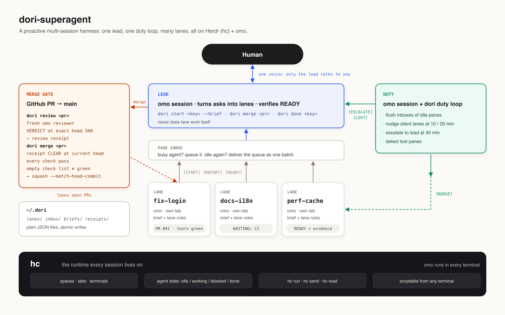
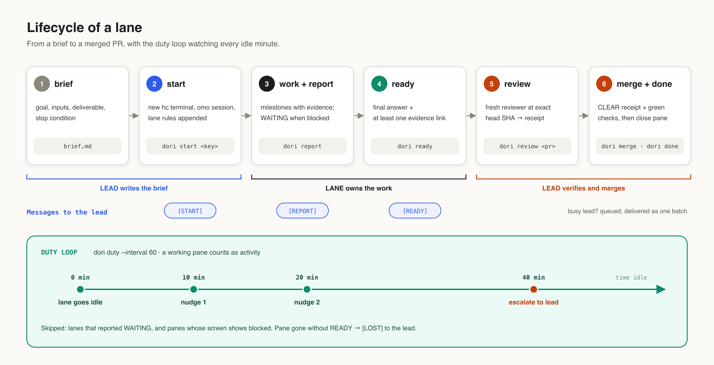

<p align="center">
  
</p>

# Dori

你的全天候工程师，就在你正在用的聊天工具里。

[English](README.md) | 简体中文 | [Deutsch](README.de.md) | [日本語](README.ja.md) | [Italiano](README.it.md)

[](https://github.com/sisyphuslabs/dori-superagent/actions/workflows/ci.yml)
[](LICENSE)

Dori 住在你的 Slack、Discord 或 Telegram 里。你在一个 thread 里告诉他要做什么，他给这项工作开一个专属的 coding agent 会话，等工作被证明完成后再回复你：一个已 merge 的 PR，一个已关闭的 issue，一个已发布的版本。两次请求之间，他会自己去找下一项任务。整套东西就这么多。

这个仓库 `dori-superagent` 就是 Dori，采用 Sustainable Use License。Dori mode（`skills/dori-mode`）是你对话的那个 bot：它由一个给你的 coding agent 用的 skill 和一个 `dori` CLI 组成，CLI 负责开启、跟踪和关闭干活的会话，也负责和 Slack、Discord、Telegram 通信。

harness（`src/`）是他背后的机房：一个 lead 会话，一个 duty loop，一个 hourly loop，宿主机能承载多少 lane 就开多少 lane，再加一个 merge gate。全部大约 4,600 行 TypeScript，跑在 [Bun](https://bun.sh) 上，没有运行时依赖。它运行在 hc（[herdr-core](https://releases.herdr.dev/core/install.sh)）和 [omo](https://github.com/code-yeongyu/oh-my-openagent) 之上。hc 是会话所在的终端运行时，会话在 Herdr 应用里显示为标签页，omo 是 coding agent，在 GitHub 上有 70.8k 星。

## 你能得到什么

- 你在 thread 里写消息。Dori 会给这条消息加一个 "eyes" 表情，一分钟内回复。任务运行期间，状态只有一条消息，由他原地编辑，每 15 分钟和每个里程碑附上一句简短的进度说明。
- 每个任务都在自己的终端里运行，也就是 Herdr 应用里的一个标签页，从启动到关闭都记录在注册表中，宿主机能承载多少就同时跑多少。当内存、磁盘或 pane 数量越过阈值时，host guard 会暂停新的启动。
- 没有证明就没有"完成"。lane 带着证据声明完成，这个声明会和实时状态对照检查：PR 已 merge，issue 已关闭，版本已在 npm 上，命令能通过，URL 能响应。站不住的声明会在 5 分钟内被退回为未完成，有未 push 工作的 lane 无法关闭。
- 只有 merge 才会通知你。lead 是唯一和你说话的会话，它在 merge 之后汇报代码变更，附上 PR 和 merge commit。lane 和 duty loop 从不和你说话。
- 你不在时工作照常进行。brief 在 backlog 里排队。loop 每小时清理已完成的条目，审查没人关闭的条目，启动下一批不需要决策的条目，并把每个悬而未决的问题只问你一次。
- 每个任务都有自己的 thread 或 Telegram topic，名称带有状态（`[working]`、`[waiting]`、`[done]`），完成后归档，你再在里面写消息时重新打开。
- 语音消息会通过你的语音转文字命令转写，然后像文字一样处理。
- 重启不会丢任何东西。你的请求工作日志、每个 lane 的检查点和注册表都存在磁盘上，`dori boot` 会先把它们读回来，Dori 才会相信自己记得的内容。
- 他用 thread 的语言回复，配合你的写作风格，消息保持简短，不用表情符号。

## Dori 住在哪里

Slack、Discord 和 Telegram 都在 `skills/dori-mode/scripts/src/messenger/` 中实现。下表列出每个平台目前能做的事；表里没有的，代码就不做。

| | Slack | Discord | Telegram |
|---|---|---|---|
| 发送并原地编辑 | 支持，并可在 thread 中回复 | 支持；文本中的提及不会通知任何人 | 支持，纯文本或带表格的 HTML |
| Thread | Slack thread | 创建、重命名和归档 thread | 论坛 topic：创建、重命名、关闭、重新打开 |
| 输入状态与流式输出 | | 输入状态提示 | 输入状态提示，以及一份随回答写出而增长的草稿，开头是 "Thinking…" |
| 入站，你的消息如何到达 | `dori inbound slack`：Threads 视图，Dori 发过言的每个 thread（无论是否被标记），以及未读的私信、群组私信和提及 | 你的消息工具自带的监听 | `dori inbound telegram`：一个长轮询，只放行所有者的消息、私信和一个群组（设置了 `DORI_TELEGRAM_TOPIC_ID` 时只放行其中一个 topic），包括编辑，媒体以 file id 形式传递 |
| 在线状态 | `dori presence slack` 让一个成员账号保持在线显示 | `dori presence discord` 在 gateway 上以在线身份登录 | |
| 文件 | 从库中上传 | | 入站媒体的 file id |
| Token | `DORI_SLACK_TOKEN`，使用用户 token 时另加 `DORI_SLACK_COOKIE` | `DORI_DISCORD_TOKEN` | `DORI_TELEGRAM_TOKEN`、`DORI_TELEGRAM_OWNER_ID`，可选 `DORI_TELEGRAM_GROUP_ID` 和 `DORI_TELEGRAM_TOPIC_ID` |

在 Slack 上，你在设置时选择 Dori 以什么身份出现。用用户 token，他就是一个真正的成员：占一个付费席位，能看到该成员看到的一切，还能挂着绿色的在线圆点。用 bot token，他就是一个应用：不占席位，只能看到被邀请进的频道，权限限于你授予的 scope。

创建 bot 和完成登录要通过 [agent-messenger](https://github.com/agent-messenger/agent-messenger)。表中的辅助模块直接调用各平台的 API，遇到限流时按服务器给出的等待时间重试，并拒绝任何包含 `$(` 的文本，因为消息文本是数据，从不经过 shell。在所有平台上，`dori transcribe` 都会通过你配置为 `hooks.transcribe` 的命令把语音消息转成文字。这个仓库不支持 Teams、WhatsApp、LINE、WeChat、iMessage、KakaoTalk 或 Lark，`dori send` 会拒绝它不认识的渠道。

`dori send <slack|telegram|discord> --to TARGET --text TEXT [--thread ID] [--edit ID]` 可以从 shell 发送或编辑消息。同样的类（`Slack`、`Discord`、`Telegram`）也是可导入的模块，它们以参数形式接收 HTTP 客户端和时钟（typing 和 presence 辅助函数接收定时器），测试正是靠这一点在不联网的情况下运行。

## 快速开始

两种安装方式都会在你的 PATH 上放一个名为 `dori` 的命令，所以每台机器只装一种。如果一台机器上两者都有，就用 `bun src/cli.ts` 运行 harness，把 `dori` 留给 Dori mode；无论哪种情况，harness 自己的提示词都用完整路径调用它。

### Dori mode，你对话的那个 bot

你需要 hc（herdr-core）、Bun 1.4.5 或更新版本、git，以及 GitHub CLI `gh`。

```sh
curl -fsSL https://raw.githubusercontent.com/sisyphuslabs/dori-superagent/main/install.sh | bash
```

这会把本仓库克隆到 `~/.dori/src`，把 skill 链接到 `~/.agents/skills/dori-mode`，把 `dori` 链接到你的 PATH 上，并把一份示例配置复制到 `~/.dori/config.json`。至少要修改 `leadPane`（你自己的 hc 终端地址，用 `echo $HC_TERMINAL_ID` 查看）、`laneWorkspace` 和 `defaultCwd`。

然后在一个 hc 终端里启动你的 coding agent，对它说：Dori mode。它会问你给它起什么名字（就叫 Dori，或者 ShipDori、WorkDori，这样几个可以并排运行），问你用哪个消息平台，和你一起完成 bot 的创建和登录，然后通过 bot 向你打招呼。在读取你的任何东西之前，它会逐个工具征求你的许可，整个引导过程是只读的。

运行约定在 [`skills/dori-mode/SKILL.md`](skills/dori-mode/SKILL.md)；设置、会话、完成协议和每条命令都在它的 [`references/`](skills/dori-mode/references/) 里。

### harness

你需要 Bun 1.4.5 或更新版本、hc（herdr-core）、omo，以及 `gh`（用于 PR head SHA、检查和 merge）。

```sh
git clone https://github.com/sisyphuslabs/dori-superagent
cd dori-superagent
bun install
bun link   # puts `dori` on your PATH
```

在 Herdr 应用的一个终端里：

```sh
dori up
# UP runtime=hc lead=t1 duty=t2 loop=t3 hourly=t4 home=~/.dori
```

这会打开四个 hc 终端：lead（omo，系统提示词后追加了 `prompts/lead.md`）、duty（omo，带 `prompts/duty.md`）、duty loop 和 hourly loop。它们是你启动时所在终端那个 space 里的标签页，名字分别是 `lead`、`duty`、`duty-loop` 和 `hourly-loop`。和 lead 对话就行。 它会写一份 brief（目标、输入、交付物、停止条件、约束；见 [`examples/brief.md`](examples/brief.md)），并自己开 lane。你也可以在 shell 里做同样的事：

```sh
dori start fix-flaky-login --brief examples/brief.md
# STARTED fix-flaky-login pane=t5 brief=~/.dori/briefs/fix-flaky-login.md
dori status
```

在 lane 内部，omo 用 lane 规则交给它的命令汇报和收尾：

```sh
dori report fix-flaky-login --text 'reproduced: 1 failure in 20 runs, shared session fixture'
dori report fix-flaky-login --status waiting --text 'WAITING: checks on owner/repo#12'
dori ready fix-flaky-login --text 'root cause fixed in owner/repo#12, checks green' --evidence https://github.com/owner/repo/pull/12
```

lead 收到 `[READY fix-flaky-login]` 时：

```sh
dori review owner/repo#12            # fresh omo reviewer pinned to the head SHA; writes a receipt; exit 0 on CLEAR
dori merge owner/repo#12 --dry-run   # MERGE_OK ... (dry run), or MERGE_REFUSED <why> with exit 2
dori merge owner/repo#12             # gh pr merge --squash --match-head-commit <sha>
dori done fix-flaky-login            # stops the lane's terminal; only a READY lane can be closed
dori done fix-flaky-login --abandon --note 'wedged, restarted as fix-flaky-login-2'   # closes one that never reported READY
```

不带参数运行 `bun src/cli.ts` 会打印每条命令和它的参数。

## harness 如何工作



三个角色，每个都是 hc 终端里的一个 omo 会话。hc 启动终端，并报告每个 agent 自己声明的状态（idle、working、blocked、done、error）；Herdr 应用把终端显示为标签页。dori 在对 pane 做任何事之前都会先读这个状态。

lead 是唯一和你说话的会话。它把请求变成 brief，用 `dori start` 开 lane，读取 lane 发回的内容，然后 merge。

一个 lane 就是一个 omo 会话，在自己的终端里，启动时带一份 brief，后面追加 lane 规则（`prompts/lane-footer.md`）。它用 `dori report` 汇报里程碑，用 `dori ready` 收尾，没有证据链接时 `dori ready` 不会发送。

duty loop 是 `dori duty --interval 60`，一个普通进程，所在 pane 紧挨着一个 duty omo 会话。每个 tick 它会把排队的消息投递到已空闲的 pane，提醒沉默的 lane，向 lead 升级，并把 pane 已消失的 lane 标记为 lost。`dori duty stop --text 'why'` 是它的停止开关；在 `dori duty resume` 之前，每个 tick 只打印它为什么停着。 它还会清理已关闭 15 分钟的 lane 的终端和标签页。

hourly loop 是 `dori loop`，由 `dori up` 在第四个 pane 里启动。工作在 `~/.dori/backlog/` 下的 backlog 里排队，每个条目一份 brief，由 lead 添加，或从带有某个标签的 GitHub issue 导入：

```sh
dori backlog add search-index --brief briefs/search.md --priority 2
dori backlog add new-billing --brief briefs/billing.md --decision 'charge per seat or per workspace?'
dori backlog import owner/repo --label dori     # label p1..p9 sets the priority, needs-decision marks a question
```

一次运行通过它的 gate（没有被停止，没有被另一个 loop 锁住，距上次运行至少隔了一个间隔）之后，先根据 lane 和 PR 的状态同步条目。接着审查漏掉的工作：沉默了 3 小时的 lane，READY 后 2 小时没人关闭的 lane，消失的 pane。然后在 `--max-lanes`（默认 3）个打开的 lane 和每次运行 `--max-starts`（默认 2）个的限制内，只要宿主机的负载和内存还有余量，就拉取下一批未完成的条目。每个悬而未决的问题以 `[DECIDE <id>]` 的形式只到达 lead 一次，6 小时后提醒一次，每次运行以一条发给 lead 的 `[LOOP ...]` 报告结束。

loop 只开 lane 和发消息；它从不 merge、push 或关闭 pane。完整设计见 [`docs/hourly-loop.md`](docs/hourly-loop.md)。



`dori start <key> --brief FILE` 把 brief 和 lane 规则写入 `~/.dori/briefs/<key>.md`，打开一个标签页，用一个指明该 brief 的提示词运行 omo，把 lane 记录为 `working`，并给 lead 发送 `[START <key>]`。之后 lane 进行汇报（`[REPORT <key>]`，或者在被自己 pane 以外的事情卡住时发 `[REPORT <key> WAITING]`），最后以 `[READY <key>]` 加上证据链接收尾。一直空闲的 lane 会在 10 分钟和 20 分钟时收到提醒，40 分钟时被升级到 lead。在 READY 之前 pane 就消失的 lane 会被报告为 `[LOST <key>]`。 lane 的 hc 终端在 READY 之前结束时也一样；用同一个 key 执行 `dori start` 会先记下这次丢失，再重新启动这个 lane。lane 变为 done 或 lost 之后 `DORI_TAB_CLOSE_MIN` 分钟（默认 15，`0` 表示从不），duty loop 会移除它的终端，并关闭它在 Herdr 应用里的标签页；在那之前，`dori done` 只是停止终端，所以它最后的屏幕内容仍然可以读到。只会动 Dori 为这个 lane 启动的那个终端，绝不会动 lead、duty 或某个 loop 的终端，仍然包含其他运行中终端的标签页也会保留。处于 idle、waiting 或 READY 的 lane 永远不会被清理。

状态以 JSON 形式存放在 `~/.dori`（或 `$DORI_HOME`）下的磁盘上：`lanes/`、`inbox/`、`briefs/`、`receipts/`，另有给 hourly loop 用的 `backlog/` 和 `loop/`，以及存放 duty loop 停止文件的 `duty/`。除了 agent 会话，harness 额外增加的长期运行进程只有这两个 loop，唯一的运行时依赖是 Bun。

### 会话运行时

会话运行在 hc（[herdr-core](https://releases.herdr.dev/core/install.sh)）上，harness 通过 `src/runtime/` 里的一个接口和它通信。`DORI_RUNTIME` 和 `$DORI_HOME/config.json` 里的 `runtime` 键只接受 `hc`。`dori status` 会先打印这个选择的来源，形如 `RUNTIME hc (from config)`；PATH 上没有 `hc` 且什么都没设置时，`dori` 会拒绝，并给出一行修复方法。

Dori 为每个会话打开一个带标签的终端。会话的状态只来自 agent 自己的报告（一个 OSC 7501 序列，最近的 omo 版本会发送）；从不报告的 agent 保持 `unknown`，发给它的消息在 inbox 里等待。hc 的服务端不继承调用方的环境，所以每个新终端启动时都带上调用方的 `DORI_*` 设置和 `PATH`。

Dori 打开的每个终端都会进入 Herdr 应用的同一个 space：`DORI_HERDR_SPACE` 指定的那个（一个 `herdr.space` id；如果那个 space 里没有任何终端就拒绝），否则是启动 `dori` 的那个终端所在的 space。随后通过 `herdr-app` 给它的标签页命名：`lead`、`duty`、`duty-loop`、`hourly-loop`，或 lane 的 key。窗口要在 hc 启动终端之后片刻才会列出它，所以标签页会被再次查找，最多 10 次，每次间隔 200 毫秒；标签页无法命名也绝不会让启动失败。`herdr-app` 不在 PATH 上时，用 `DORI_HERDR_APP` 指定它的路径。在 Herdr 应用之外启动且没有设置 `DORI_HERDR_SPACE` 时，终端不会被放进任何 space。细节见 [`docs/runtime.md`](docs/runtime.md)。

## harness 强制执行什么

### 一个声音

lead 是唯一和你说话的会话（`prompts/lead.md`）。lane 规则把每条要给你的信息都发给 lead（`prompts/lane-footer.md`，第 3 条），duty 会话从不 merge，也从不和你说话（`prompts/duty.md`）。

### READY 需要证据

没有至少一个 `--evidence` 链接、没有最终回答文本时，`dori ready` 会拒绝。两者都存在 lane 记录里，而 `dori done` 会拒绝任何不是 `ready` 的 lane，所以没有 lane 能在没有记录回答的情况下关闭。 唯一的例外是 lead 的 `dori done <key> --abandon --note 'why'`，用于永远不会报告 READY 的 lane：这时原因会记在 lane 的日志里。

### 忙碌的 pane 从不被打断，也不会重复发送

`dori send` 先向 hc 询问 pane 的 agent 状态。`idle` 或 `done` 的 pane 立即收到消息；其他状态的则把消息排进 `~/.dori/inbox/`，等 pane 空闲后由 duty loop 一次性批量投递。前台是 shell 的 pane 从不会被输入，因为输入的文字会被当作命令执行。

hc 把粘贴消息和按 Enter 合成一步，如果期间 agent 的状态变了，它会拒绝这一步。如果这一步失败了却没说明文字是否送达，该条目会被搁置，绝不会自动重发：lead 会收到一次 `[DELIVERY-AMBIGUOUS <pane>]`，由 `dori inbox ack` 或 `dori inbox resend` 手动处理。

### 10、20 和 40 分钟的提醒

一个 10 分钟没有汇报、pane 也不在 working 状态的 lane，会在 pane 里收到 `prompts/nudge.md`，20 分钟时再收到一次，40 分钟时 duty loop 给 lead 发送 `[ESCALATE <key>]`。汇报过 `--status waiting` 或 pane 处于 `blocked` 的 lane 不会被打扰。

### merge 需要精确 head 上的 CLEAR receipt 和全绿的检查

`dori merge` 用 `gh` 读取 PR 的 head SHA，然后要求 `~/.dori/receipts/` 中有一份针对该 SHA、结论为 `CLEAR` 的 receipt。只有 `dori review` 会写 receipt：它基于 `prompts/review.md` 运行一个全新的非交互式 omo，固定在该 SHA 上；如果 reviewer 没有打印 `VERDICT:` 行，就不写 receipt。 没有 `VERDICT:` 行的一次运行会重跑一次，连续两次都没有，review 就失败。超过 `DORI_REVIEW_TIMEOUT_MIN` 分钟（默认 25）的运行会连同子进程一起被终止，并让 review 失败，除非它已经打印了结论。reviewer 的完整输出保存在 receipt 旁边的 `receipts/<pr>@<sha>.md` 里，review 失败时也保存；每次运行还会在 `receipts/<pr>@<sha>.attempts/` 下留下 stdout、stderr、结果和会话文件。`DORI_AGENT_CMD` 可以是一个可执行文件后面跟固定参数（支持引号和反斜杠转义，不做 shell 展开）。

接着 `gh pr checks` 必须返回至少一个检查，每个检查都必须是 `pass` 或 `skipping`，且至少一个是 `pass`。空的检查列表会被拒绝，理由是 "an empty check list is never green"。review 之后的 push 会改变 head SHA，receipt 就不再匹配，`dori review` 需要重新运行。

设置 `LANDING_BACKEND`，可以把 PR 交给一个 landing 队列，而不是自己 merge：

```sh
export LANDING_BACKEND='["/absolute/path/to/landing-backend","submit"]'
dori merge owner/repo#123
```

这个值是一个 JSON 数组，由一个可执行文件和它的字面参数组成，启动时只解析一次，绝不通过 shell 执行。Dori 会重新读取 head，head 变了就拒绝，然后在后面加上 `--repo owner/repo --pr 123 --expected-head FULL_SHA` 调用后端。后端必须以 0 退出，并打印一个重复了 `repo`、`pr` 和 `expectedHead` 的 JSON 对象。`"status":"queued"` 打印 `QUEUED owner/repo#123 head=FULL_SHA`，只表示已被接收。`"status":"landed"` 必须带有各 40 个十六进制字符的 `landedHead` 和 `landedTree`，以及一个非空的 `receipt`，指明队列自己的凭证，然后连同它们打印 `MERGED`。其他任何回答都会被拒绝，不会退回到直接 merge。`--dry-run` 只检查是否可以接收，绝不调用后端。

`formaengine/forma-rs` 只通过它自己的队列 landing：它必须有 `LANDING_BACKEND`，没有 dry run，也不看它的 GitHub 检查，因为 landing 由队列自己验证。当这个后端运行 Python，或者 `FORMA_QUEUE_BOOTSTRAP`（一个带 `repo`、`pr`、`head` 和 `tree` 的 JSON 对象）指明了唯一允许从自己的检出运行的 PR head 时，Dori 会在任何东西运行之前检查源码。后端必须正好是 `["python3", "/absolute/source/.agents/workflows/landing-verifier.py"]`，位于该仓库的一个干净检出里，处在指定的 head 和 tree 上，未指定时处在刚拉取的 `origin/main` 上，并且 `.agents/workflows` 和 `specs` 下没有符号链接、字节码或未被跟踪的可导入文件。然后它以 `python3 -I -S -B <script>` 运行。

### 给你自己工具用的 hook

`$DORI_HOME/config.json` 可以在 `hooks` 下指定 argv 模板：`onReady`、`onReport` 和 `onLost` 在对应事件发生时于后台运行（每个参数中的 `{key}`、`{text}` 和 `{evidence}` 会被填入），`reviewCommand` 可以替换内置的 reviewer，只要它打印同样的 `VERDICT:` 行。`DORI_PROMPTS_DIR` 让 harness 使用你自己的提示词副本。

## 深入 Dori mode

### 路由

问题、状态查询、查找或小改动在 Dori 自己的会话里处理。会以 PR 形式落地的代码、多步骤的工作，或者任何耗时长、需要并行的事情，都会开一个 lane；如果已经有一个空闲的 lane 负责那个仓库或主题，工作就交给它。如果 `dori can-launch` 返回 `HOLD`（内存、磁盘或 pane 数量超过 guard 的阈值），就不会开任何东西，你会被告知原因以及何时开始。

### 完成是一个声明，而不是事实

`dori launch` 只接受 watcher 能自己读回每个信号的 `Done =` 行。信号之间用 `;` 连接，全部通过时 lane 才算完成：

| 信号 | 通过条件 |
|---|---|
| `merged <owner/repo>#N` | PR 已 merge 且有 merge commit |
| `closed <owner/repo>#N` | issue 已关闭 |
| `published <pkg>@<version>` | npm 上有这个确切版本 |
| `command ["argv","as","json"] [stdout~"regex"]` | 命令以 0 退出，如果给了 regex，stdout 要匹配它 |
| `file <path> [sha256=<hex>] [json:.a.b=<value>]` | 文件存在，sha256 匹配，JSON 字段等于给定值 |
| `url <http(s) url> [status=200] [body~"regex"]` | GET 返回该状态码，如果给了 regex，body 要匹配它 |

lane 用 `dori claim-done <key> --evidence "..."` 声明完成。`dori watch` 处理超过 5 分钟的声明：未 push 或未 commit 的工作以及未通过的信号会变成异议，否则 lane 被关闭：配置了 thread hook 时它的 thread 被标记为完成，标签页被关闭，worktree 被删除。

### 在称一个 PR 完成之前

`dori verify-pr <owner/repo> <num>` 通过 `gh api` 读取 PR，检查每个 commit 的作者和提交者邮箱都是该仓库配置的身份，并检查涉及源码的 `fix:` commit 附带了改动过的测试，或者写明了 `No test:` 理由。

### 经验

`dori lesson add` 记录 lane 在某个仓库里学到的一条规则，并和教会它这条规则的证据绑定。`--global` 经验是 lead 给所有 lane 的常设规则。`dori launch` 会把当前有效的经验放在下一份 brief 的上方。

### 监督

每个 `freshness` tick 会把已启动的 lane 和可选的上限对照：挂钟分钟数、token 和成本（来自你配置的用量命令）。如果 lane 的 `Working` 计时器持续增长 20 分钟，却没有新的汇报、检查点或文件变化，就标记为停滞。达到上限的 lane 从不会被杀掉；它会等待 lead。

### 当你说等一下

`dori pause <key>` 暂停 lane 的目标并停止它正在进行的轮次，如果无法确认暂停成功，会打印 `PAUSE_UNVERIFIED`。`dori resume <key>` 让它恢复。

## 同样的结构，同样的理念

DeepSeek 发布了 [dsh-superagent-prototype](https://github.com/deepseek-ai/dsh-superagent-prototype)（首次 commit 于 2026-10-31），大约一天后又发布了文章 "Exploring Super-agent Design: Towards a More Autonomous Agent System"。把它的文档和 Dori 放在一起，概念一一对应，无论是流水线，还是他们 [理念文档](https://github.com/deepseek-ai/dsh-superagent-prototype/blob/main/docs/000-philosophy.md) 里的规则。


| DeepSeek dsh-superagent | Dori |
|---|---|
| 来源：GitHub、飞书 | Dori 住在聊天工具里：Slack、Discord、Telegram |
| Trigger，然后 Eval，然后 Ticket | 聊天中提出的一项任务变成一个 lane 和一份 brief |
| 每个 ticket 一个 Executor 会话：一个会话，一个工作目录 | 每项任务一个 coding agent 会话，在自己的终端里，多个并行 |
| Channel：在原对话中回答，例如附上一个 PR | 在同一个 thread 里汇报，每项任务一条状态消息，原地编辑 |
| Panel：只展示需要人处理的内容 | lead 只在决策不可逆或会改变产品时才问你 |
| 最少的人类注意力，最大的价值 | 简短的消息，不用表情符号，只在 merge 之后通知 |
| 只在被要求或成文的团队规则允许时才行动 | Dori 不会开始没人要求的工作；backlog 里只有你排进去的东西 |
| 只在需要人行动时才说话，一次一个问题 | 决策以带编号的选项给出，并附上他自己的选择 |
| 如实汇报，从不绕过阻碍 | 没有证明就没有"完成"，阻碍就按阻碍汇报 |

我们公开地运行这种形态已经大约六个月了：

- 2026-04-18：team mode 进入 omo，多个 agent 会话分布在终端 pane 里，每个各有一个 worktree（[f1268c0](https://github.com/code-yeongyu/oh-my-openagent/commit/f1268c0)，[e303fee](https://github.com/code-yeongyu/oh-my-openagent/commit/e303fee)）。
- 2026-05-06：Dori 这个名字进入 omo 的 README（[#3807](https://github.com/code-yeongyu/oh-my-openagent/pull/3807)）。
- 2026-10-07：本仓库以 `omo-dori-mode-experimental` 之名发布 Dori mode（[ce53e4d](https://github.com/sisyphuslabs/dori-superagent/commit/ce53e4d)）。
- 2026-10-31：DeepSeek 的原型迎来首次 commit。

omo 本身就是这样构建的。2026-07-13 到 2026-11-08 之间，[code-yeongyu/oh-my-openagent](https://github.com/code-yeongyu/oh-my-openagent) merge 了 2,846 个 pull request，落地了 18,780 个 commit（计入所有贡献者），都是用这套设置的完整版本产出的。本仓库中的 harness 是最小版本：只依靠 hc 和 omo 就能运行的那部分。

## 配置

harness 环境变量：

| 变量 | 默认值 | 含义 |
|---|---|---|
| `DORI_HOME` | `~/.dori` | 状态目录 |
| `DORI_AGENT_CMD` | `omo` | 每个 pane 运行的 agent |
| `DORI_RUNTIME` | `hc` | 会话运行时；只接受 `hc`（herdr-core），`$DORI_HOME/config.json` 里的 `runtime` 键也一样；PATH 上没有 `hc` 且什么都没设置时，`dori` 会拒绝，并给出一行修复方法 |
| `DORI_HERDR_SPACE` | 启动 `dori` 的终端所在的 space | 所有 Dori 终端进入的 Herdr 应用 space 的 `herdr.space` id |
| `DORI_HERDR_APP` | PATH 上的 `herdr-app` | 用来给标签页命名和关闭标签页的 `herdr-app` 可执行文件 |
| `DORI_REVIEW_TIMEOUT_MIN` | 25 | 一次 reviewer 运行最多可以用的分钟数 |
| `DORI_TAB_CLOSE_MIN` | 15 | lane 变为 done 或 lost 之后，过多少分钟清理它的终端和标签页；`0` 表示从不清理 |
| `LANDING_BACKEND` | | `dori merge` 把 PR 交给的 landing 队列，写成 JSON argv 数组 |
| `FORMA_QUEUE_BOOTSTRAP` | | 唯一允许作为 `formaengine/forma-rs` landing 后端运行的 PR head 的 `{repo, pr, head, tree}` |
| `DORI_CMD` | `src/cli.ts` 的完整路径 | 告诉 agent 如何调用 dori |
| `DORI_PROMPTS_DIR` | 仓库的 `prompts/` | 你自己的提示词文件 |
| `DORI_MAX_LANES`, `DORI_MAX_STARTS`, `DORI_MAX_LOAD` | 3、2、核心数 | hourly loop 的预算 |
| `DORI_TELEMETRY`, `DORI_TELEMETRY_ENDPOINT` | 开启，`https://t.omo.dev` | `0` 关闭遥测 |

Dori mode 读取 `~/.dori/config.json`（或 `DORI_CONFIG`）；每个字段都是可选的，[`config.example.json`](skills/dori-mode/references/config.example.json) 列出了全部字段。你最先会设置的是：`leadPane`、`laneWorkspace`、`defaultCwd`、`agentCommand` 和 `defaultModel`，`repoIdentities`（`verify-pr` 对每个仓库期望的 Git 名字和邮箱），`hooks.threadReply` 和 `hooks.threadDone`（你的消息 CLI，以带 `{thread}` 和 `{text}` 的 argv 模板形式），`hooks.transcribe`，以及 `guard`（负载、空闲内存、空闲磁盘和 pane 数量）。时间默认值：安静 15 分钟后提醒，20 分钟后把最后一条汇报发到 thread，完成声明在 5 分钟后处理。

## 在容器中运行

[`examples/container/`](examples/container/) 里有一个 Dockerfile、一个 compose 文件和一个入口脚本，用于一个长期运行的容器，内含 gh、node、bun、hc、agent-messenger、omo 和 harness：每个下载的二进制文件都会和固定的 sha256 核对，npm 包和 harness 按版本和 commit 固定。不发布镜像。你自己构建，在运行中的容器里完成一次登录，命名卷会保留它们。[`docs/container.md`](docs/container.md) 讲了构建、首次运行以及如何连接。

## 遥测

dori 以和 omo 相同的方式发送匿名使用计数：以 OTLP/HTTP JSON 日志形式发到位于 `https://t.omo.dev` 的 omo 收集器。身份是一个保存在 `~/.dori/telemetry.json` 中的随机安装 id，只发送它的 sha256。首次发送时，收集器根据这个哈希生成一个按安装区分的 ingest key；代码里不附带任何共享 key。首次运行会打印一行提示。用 `DORI_TELEMETRY=0` 关闭它（`DO_NOT_TRACK=1` 也可以）。

| 事件 | 时机 | 字段 |
|---|---|---|
| `dori.installed` | 首次运行 | 无 |
| `dori.daily_active` | 每个 UTC 日一次，任意 dori 命令触发 | `day_utc` |
| `dori.lane_started` | `dori start` | `open_lanes` |
| `dori.lane_ready` | `dori ready` | `evidence_count`, `lane_minutes` |
| `dori.review_completed` | `dori review` | `verdict`：`CLEAR` 或 `BLOCK` |
| `dori.merge_decided` | 不带 `--dry-run` 的 `dori merge` | `outcome` |
| `dori.duty_summary` | 最多每小时一次，来自 duty loop | `ticks`, `flushed`, `nudges`, `escalations`, `lost` |

每条记录还带有服务名称和版本、安装哈希、一个 CI 标志、操作系统类型和版本，以及 CPU 架构。从不发送：路径、仓库名、PR 编号、lane key、brief、消息或任何其他文本。命令最多等待发送 2 秒，遥测失败从不会让命令失败。

## 测试与开发

```sh
bun test ./test/                                  # the harness: 386 tests across 42 files, no model calls
cd skills/dori-mode/scripts && bun install && bun test   # Dori mode: 321 tests across 44 files
bun run ci                                        # biome, tsc, knip, the 250-line check, both suites
```

harness 的测试在假的 hc 和假的 gh 上运行，时钟由测试推进；端到端测试会在隔离的会话里启动真实的 hc core，用一个假的 agent 脚本代替 omo，`hc` 不在 PATH 上时自行跳过。Dori mode 的测试在假的 hc、git 和 gh 上运行，不碰任何真实的东西。CI 在 Ubuntu 和 macOS 上运行同样的测试。

## 这不是什么

harness 是最小版本，不是我们的生产栈。有意省略的部分：跨机器网格、heavy-slot 调度、聊天和工单跟踪系统的桥接，以及整套测试的 receipt。只依靠 hc 和 omo 就能运行的部分都在这里：角色、lane、inbox、duty loop、hourly loop 和 backlog，以及 review 和 merge gate。Dori mode 是一个独立的 CLI，有自己的消息组件、host guard 和 heavy-slot runner；harness 不从它导入任何东西。

## 参与贡献

每位贡献者只需签署一次[贡献者许可协议](CLA.md)：在第一个 pull request 下评论 `I have read the CLA Document and I hereby sign the CLA`，CLA Assistant 检查会记录下来。各项门禁、测试命令和 pull request 规则见 [CONTRIBUTING.md](CONTRIBUTING.md)。

## 许可证

[Sustainable Use License](LICENSE) 1.0 版，与 omo 使用的许可证相同，第三方组件遵循各自的许可证。它覆盖你自己的内部业务用途以及非商业或个人用途；商业用途需要向所有者取得许可。`ba96abf` 之前的提交以 MIT 许可证发布。
